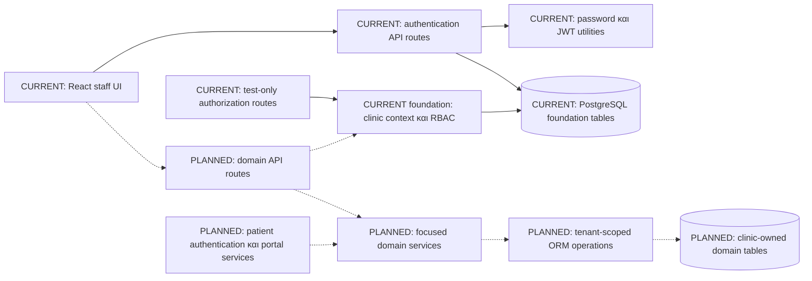
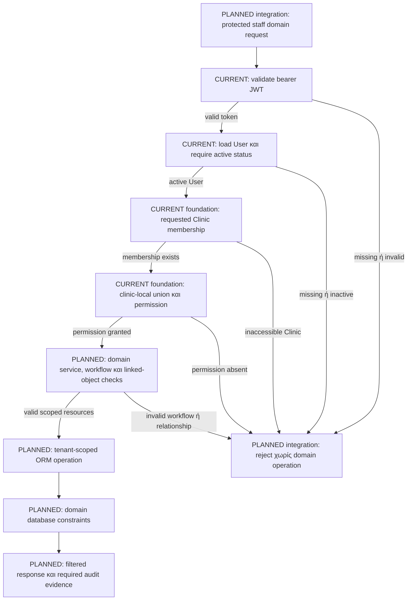
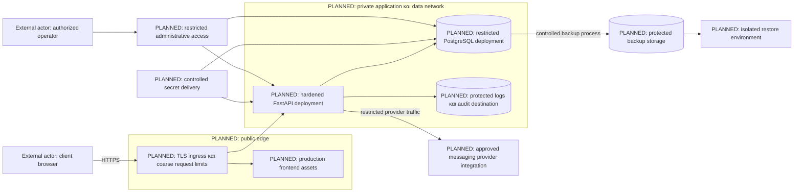

# Αρχιτεκτονική Ασφάλειας — med-app

## 1. Στοιχεία εγγράφου, baseline και scope

| Πεδίο | Τιμή |
|---|---|
| Εργασία | SECURITY-00C |
| Έκδοση / ημερομηνία | 1.0 / 2026-10-30 |
| Κατάσταση | Τεκμηρίωση υφιστάμενης υλοποίησης και προτεινόμενης αρχιτεκτονικής· όχι production approval |
| Branch | `feature/clinic-authorization` |
| Baseline commit | `af533cbd721c00eae203ac8ff8a6592675724da2` |
| Βάση σχεδιασμού | Ολοκληρωμένη read-only επιθεώρηση SECURITY-00C και στοχευμένη διασταύρωση source, tests και configuration |
| Κύρια προδιαγραφή | [System Specification v1.0](../system-specification.md), ιδίως §§5–6, 12, 14, 19–24, 26–27 και 31 |
| Απαιτήσεις ασφάλειας | [SECURITY-REQUIREMENTS.md](SECURITY-REQUIREMENTS.md), SEC-001 έως SEC-032 |
| Μοντέλο απειλών | [THREAT-MODEL.md](THREAT-MODEL.md), TM-001 έως TM-018 |

Το έγγραφο περιγράφει πού εφαρμόζονται οι έλεγχοι ασφάλειας και πώς πρέπει να επεκταθούν στα μελλοντικά domain workflows. Δεν αλλάζει τον κώδικα, το schema, τα endpoints ή τα υπάρχοντα security documents.

Οι όροι **CURRENT / Υφιστάμενο** αφορούν evidence στο baseline. **Foundation** σημαίνει υλοποιημένη βάση με περιορισμένο εύρος, όχι ολοκληρωμένη domain προστασία. **PLANNED / Προτεινόμενο** σημαίνει σχεδιασμό που δεν έχει ακόμη υλοποιηθεί ή επαληθευθεί. **Unknown** σημαίνει έλλειψη επαρκούς evidence, ιδίως για εξωτερική υποδομή. Η ύπαρξη configuration δεν αποδεικνύει ότι εκτελείται σήμερα κάποια εγκατάσταση.

Οι αναφορές E01–E12 και T01–T11 διατηρούν τη σημασία τους από το SECURITY-REQUIREMENTS.md. Οι αναφορές C1–C7 στο THREAT-MODEL.md περιγράφουν τα ίδια υφιστάμενα controls. Τα παλαιότερα baseline commits αυτών των εγγράφων είναι ιστορικά στοιχεία επιθεώρησης, όχι ασυμφωνία με το παρόν baseline.

**Τα υπάρχοντα tests επιθεωρήθηκαν ως κείμενο. Δεν εκτελέστηκαν application tests ή migrations κατά το SECURITY-00C.** Δεν έγινε live deployment review, dependency vulnerability scan ή επιθεώρηση πραγματικών secret values. Δεν δηλώνεται security certification ή επιτυχής εκτέλεση των προτεινόμενων verification ενεργειών.

## 2. Synthetic-data demo και μελλοντική παραγωγή

Σήμερα επιτρέπονται μόνο ανάπτυξη και ελεγχόμενη ακαδημαϊκή επίδειξη με **συνθετικά δεδομένα**. Δεν επιτρέπονται πραγματικά δεδομένα ασθενών ή δημόσια παραγωγική εγκατάσταση. Η απλή ψευδωνυμοποίηση ή αντιγραφή πραγματικού φακέλου δεν αποτελεί συνθετικό dataset.

Η αρχιτεκτονική πρέπει να υποστηρίζει πιθανή μελλοντική χρήση από πραγματικά ιατρεία. Αυτός ο στόχος δεν αποτελεί τρέχουσα εξουσιοδότηση. Πριν από πραγματικά δεδομένα απαιτούνται ξεχωριστό production-readiness gate, τεκμηριωμένο verification και ρητή νέα έγκριση του project owner.

Τα συνθετικά δεδομένα δεν καταργούν την ανάγκη προστασίας πραγματικών developer credentials, signing keys, DB credentials, host και source/build artifacts. Η διαθεσιμότητα της επίδειξης και η ακεραιότητα του λογισμικού παραμένουν assets ασφάλειας.

**Η συμμόρφωση με τον GDPR δεν έχει τεκμηριωθεί.** Οι SEC-030 και SEC-031 καλύπτουν εκκρεμή privacy/governance αξιολόγηση. Το παρόν δεν αποτελεί νομικό συμπέρασμα ούτε υποκαθιστά την αξιολόγηση πριν από πραγματική επεξεργασία.

## 3. Αρχιτεκτονικές αρχές και εγκεκριμένες αποφάσεις

1. Διατηρείται **modular FastAPI monolith**. Δεν εισάγονται microservices ή γενικό authorization/repository framework.
2. Η κατεύθυνση είναι API → focused services → tenant-scoped ORM operations → PostgreSQL. Η προδιαγραφή §20 ορίζει αυτή τη διάκριση ευθυνών.
3. Routes χειρίζονται HTTP, input schemas, authentication, authorization και service invocation. Services χειρίζονται business rules και transaction boundaries.
4. Ο authenticated actor, η Clinic, η permission και το resource ελέγχονται διαδοχικά. Ένα έγκυρο JWT δεν συνεπάγεται έγκυρη membership ή πρόσβαση σε κάθε object.
5. Ο OWNER έχει όλες τις δηλωμένες permissions μόνο στη δική του Clinic, συμπεριλαμβανομένων `medical_records.read` και `medical_records.write`, ακόμη και χωρίς DOCTOR.
6. OWNER και `is_superuser` δεν έχουν cross-clinic bypass. Πολλαπλά roles συνδυάζονται μόνο στην ίδια clinic membership.
7. OWNER δεν μετατρέπεται αυτόματα σε Doctor profile. Στα μελλοντικά clinical workflows καταγράφονται χωριστά acting User και responsible Doctor. Το ακριβές schema και οι attribution κανόνες παραμένουν προς σχεδιασμό.
8. Patients δεν είναι staff Users. AMKA + OTP και patient sessions παραμένουν ανεξάρτητα από staff authentication.
9. Τα δεδομένα και οι σχέσεις περιορίζονται ανά Clinic σε API, service, ORM, database και response επίπεδο. Opaque IDs ή UI guards δεν αντικαθιστούν authorization.
10. Η αποτυχία ελέγχου δεν επιτρέπει domain operation. Εφαρμόζονται least privilege, ελαχιστοποίηση outputs και ελεγχόμενα errors.
11. Κάθε schema change θα απαιτεί reviewed Alembic migration. Το παρόν δεν εγκρίνει συγκεκριμένη schema αλλαγή.
12. Τα intelligent features παραμένουν υποβοηθητικά και δεν λαμβάνουν αυτόνομες ιατρικές αποφάσεις, σύμφωνα με την προδιαγραφή §17.

Η ευρεία πρόσβαση OWNER είναι εγκεκριμένη συμπεριφορά, όχι από μόνη της privilege-escalation bug. Αυξάνει όμως την έκθεση σε insider misuse. Χρειάζονται auditability, κατάλληλη πολιτική χρήσης, privacy assessment και tests που αποδεικνύουν το clinic boundary.

## 4. CURRENT components, responsibilities και evidence

| Component | Σημερινή ευθύνη | Repository evidence / περιορισμός |
|---|---|---|
| React app και UI | Login/dashboard navigation και παρουσίαση στοιχείων τρέχοντος χρήστη | [App.tsx](../../frontend/src/App.tsx), `frontend/src/pages/`, `frontend/src/layouts/`· όχι domain UI υλοποίηση. |
| AuthProvider | Login→me sequence, memory-only state, local logout, pending/stale-response handling | [AuthProvider.tsx](../../frontend/src/auth/AuthProvider.tsx), T08/T11· όχι server revocation. |
| ProtectedRoute | Redirect μη authenticated UI χρήστη | [ProtectedRoute.tsx](../../frontend/src/auth/ProtectedRoute.tsx)· δεν προστατεύει API. |
| Frontend API client | Form-encoded login, bearer `/auth/me`, status classification και σταθερά error messages | [auth.ts](../../frontend/src/api/auth.ts), [client.ts](../../frontend/src/api/client.ts), T09/T10. |
| FastAPI application | Router inclusion, `/`, `/health/db`, default docs/schema | [main.py](../../backend/app/main.py)· δεν υπάρχει συνολικό endpoint allowlist policy. |
| Authentication routes | Public register/login, hashing, DB operations και protected `/auth/me` | [auth.py](../../backend/app/api/auth.py)· business/transaction logic βρίσκεται σήμερα στο route. |
| Password/JWT utilities | bcrypt, token signing/expiry, required claims και validation user ID | [security.py](../../backend/app/core/security.py), T01· όχι πλήρης password/session policy. |
| Current-user dependency | Bearer extraction, token validation, current User lookup και active check | [deps.py](../../backend/app/api/deps.py), T02/T03. |
| Clinic/RBAC foundations | Membership lookup, role union, permission denial και no-superuser-bypass | `deps.py`, [permissions.py](../../backend/app/core/permissions.py), T04/T05/T06· σήμερα μέσω test-only routes. |
| SQLAlchemy/PostgreSQL foundation | Engine/session lifecycle, Users, Clinics, memberships και roles | [session.py](../../backend/app/db/session.py), [models](../../backend/app/db/models/__init__.py), E10/T07. |
| Settings | Environment-based configuration, απαιτούμενο signing secret και βασικό validation | [config.py](../../backend/app/core/config.py), [.env.example](../../.env.example)· όχι production validation/rotation lifecycle. |
| Development containers | PostgreSQL, Uvicorn reload και Vite development server | [Compose](../../docker-compose.yml), [Backend Dockerfile](../../backend/Dockerfile), [Frontend Dockerfile](../../frontend/Dockerfile). |

Δεν υπάρχει σήμερα service layer για Patient, MedicalRecord, Appointment ή Payment workflows. Patient resource-level tenant isolation είναι **PLANNED**, όχι ήδη παρεχόμενη προστασία από τα dependencies.

OTP, application audit logging, rate limiting, production TLS, backup recovery και production hardening **δεν έχουν επαληθευθεί ως υλοποιημένα**. Το default server logging δεν αποτελεί audit trail. Το persistent volume δεν αποδεικνύει backup ή recovery.

## 5. CURRENT authentication και clinic/RBAC flows

### 5.1 Registration

Το public `POST /auth/register` δέχεται `UserCreate`, ελέγχει email, υπολογίζει password hash, δημιουργεί User, κάνει commit και επιστρέφει `UserOut`. Δεν δημιουργεί Clinic membership ή roles. Το μοντέλο έχει active default. Το duplicate-email response διακρίνει την ύπαρξη λογαριασμού.

Το OWNER bootstrap και invitations για DOCTOR/SECRETARY είναι **PLANNED**. Η δημόσια registration δεν είναι υλοποίηση αυτού του σχεδιασμού και δεν τεκμηριώνει σημερινό clinic-access bypass.

### 5.2 Login, current user και logout

1. Ο browser στέλνει form-encoded credentials στο `/auth/login` μέσω του Vite `/auth` proxy.
2. Το backend αναζητά User και επαληθεύει password.
3. Εκδίδει JWT με `sub` και `exp`. Το login δεν ελέγχει `is_active` πριν εκδώσει token.
4. Ο frontend client καλεί `/auth/me` με `Authorization: Bearer ...`.
5. Το `get_current_user` επαληθεύει token, αναζητά τον σημερινό User και απαιτεί `is_active is True`.
6. Ο AuthProvider γίνεται authenticated μόνο μετά από επιτυχές `/auth/me`.
7. Το logout καθαρίζει το client state. Δεν ανακαλεί ήδη αντιγραμμένο JWT στο backend.

Missing/invalid credentials και ανύπαρκτος User απορρίπτονται με `401`. Inactive User απορρίπτεται με `403` στο protected dependency. Τα response schemas αποκλείουν τον password hash. Αυτές οι συμπεριφορές έχουν υπάρχοντα test assertions, όχι εκτέλεση tests σε αυτή την εργασία.

### 5.3 Clinic membership και permission

Το `get_current_clinic_membership` χρησιμοποιεί τον authenticated User και το validated path `clinic_id`. Το query περιλαμβάνει και τα δύο IDs, φορτώνει Clinic/roles και επιστρέφει κοινό `404` για ανύπαρκτη ή μη προσβάσιμη Clinic. Το `require_permission` υπολογίζει permissions μόνο από τα roles αυτής της membership και επιστρέφει `403` όταν λείπει η απαιτούμενη permission.

Τα T04/T06 περιέχουν ελέγχους για role changes με ίδιο JWT, ανεξάρτητα clinic contexts, empty roles και no-superuser-bypass. Ελέγχουν επίσης ότι τα test-only routes δεν είναι καταχωρισμένα στην production application. Το `/auth/me` δεν απαιτεί clinic context. Το πλήρες domain authorization flow δεν λειτουργεί ήδη σε Patient endpoints.

Το `API_PREFIX` υπάρχει στο settings αλλά δεν εφαρμόζεται στο `include_router`. Πραγματικά authentication endpoints είναι `/auth/*`. Τα deployment controls πρέπει να ακολουθούν τις πραγματικές διαδρομές.

## 6. PLANNED modular FastAPI architecture

### 6.1 Ευθύνες ανά επίπεδο

| Επίπεδο | Προτεινόμενη ευθύνη |
|---|---|
| API / schemas | HTTP contract, schema validation, authenticated principal, clinic/permission dependencies, service call και filtered response. |
| Service | Business rules, object authorization, same-clinic links, state transitions, transaction και απαιτούμενα audit events. |
| ORM / focused data-access functions | Παραμετροποιημένα και tenant-scoped queries, joins, mutations και aggregates. Δεν κάνουν ανεξάρτητο commit. |
| PostgreSQL | Constraints, referential integrity, uniqueness, εγκεκριμένη concurrency protection και περιορισμένα runtime privileges. |

Η υπάρχουσα δομή `api/`, `schemas/`, `core/`, `db/` διατηρείται. Μελλοντικά προστίθενται μικρά domain services και τα αναγκαία domain schemas/models/routes. Focused query helpers μπορούν να προστεθούν όταν εξυπηρετούν πραγματική ανάγκη. Δεν απαιτείται γενικό repository interface, global tenant framework ή νέα εξάρτηση για αυτή τη διάκριση.

Ο caller του service παρέχει trusted actor/context από τον κατάλληλο validator. Services που καλούνται και από jobs ή εσωτερικό κώδικα δεν θεωρούν ότι το HTTP route έχει ήδη εξουσιοδοτήσει τα πάντα. Κάθε είσοδος έχει σαφές authorization contract. Δεν χρησιμοποιείται global mutable «current Clinic».

### 6.2 Transactions και εξωτερικές ενέργειες

Το service ορίζει την atomic unit της λειτουργίας. Έλεγχοι, αλλαγές και απαιτούμενο mutation audit evidence συνδέονται με την ίδια επιτυχή συναλλαγή όπου πρακτικό. Αποτυχία προκαλεί rollback και ελεγχόμενο error. Η ακριβής transaction ownership με το υφιστάμενο Session θα καθοριστεί στην implementation εργασία, χωρίς ανεξάρτητα commits σε helpers.

Notifications/provider calls δεν κρατούν ανοιχτή κλινική συναλλαγή. Η αποτυχία δευτερεύουσας ειδοποίησης δεν πρέπει να ακυρώνει ήδη ολοκληρωμένη βασική λειτουργία. Αν απαιτηθεί εγγυημένη παράδοση, μπορεί να αξιολογηθεί transactional outbox ως ξεχωριστή σχεδιαστική απόφαση· δεν είναι υλοποιημένο component.

### 6.3 Component diagram

Τα labels ορίζουν κατάσταση κόμβων. Τα solid arrows περιγράφουν τρέχουσες εξαρτήσεις. Τα dashed arrows περιγράφουν μελλοντική integration. Πρόκειται για λογική αρχιτεκτονική ενός monolith, όχι για δίκτυο microservices.

Οι DB και DOMAIN κόμβοι μπορούν να ανήκουν στην ίδια φυσική PostgreSQL. Ο διαχωρισμός δείχνει σημερινά tables και μελλοντικό schema, όχι ξεχωριστή DB ανά tenant. Το PORTAL→SERVICES σημαίνει περιορισμένη επαναχρησιμοποίηση επιτρεπόμενων appointment operations με patient context. Δεν σημαίνει αποδοχή patient session ως staff authority ή πρόσβαση σε όλα τα domain services.

## 7. PLANNED domain modules

| Module | Responsibilities και security contract |
|---|---|
| Patients | Clinic-owned demographics/contact data, scoped CRUD/search και administrative responses. Clinical content δεν επιστρέφεται αυτόματα από Patient list/detail για διοικητικούς callers. AMKA δεν λειτουργεί ως απόδειξη ταυτότητας ή ως δικαίωμα global lookup. |
| Medical Records | Clinic/Patient-scoped clinical read/write με `medical_records.read` / `medical_records.write`, attribution και audit evidence. OWNER-only επιτρέπεται εντός Clinic· SECRETARY χωρίς πρόσθετο clinical role όχι. |
| Appointments | Same-clinic Patient και doctor, διαχείριση κατάστασης/διάρκειας, επιτρεπόμενες μεταβολές και concurrency-safe conflict prevention. Cancellation/rescheduling eligibility ορίζεται πριν το Portal. |
| Payments | Εσωτερικά clinic-scoped records, Patient και προαιρετικό Appointment, ποσό/method/time/notes και περιορισμένα statistics. Δεν εισάγονται invoices, receipts, tax/accounting integrations ή card-processing functionality. |
| Patient Portal | Ξεχωριστή AMKA + OTP verification, περιορισμένη patient session και μόνο upcoming appointments/eligible cancellation/rescheduling. Καμία medical-record πρόσβαση. |
| Staff administration | Initial OWNER bootstrap, invitations και authorized membership/role changes. Server-side clinic scope και audited lifecycle· όχι ανάθεση roles από ανεξέλεγκτα registration fields. |

### 7.1 Clinical attribution

Ο **acting User** είναι η ταυτότητα που πραγματοποίησε την ενέργεια. Ο **responsible Doctor** είναι η κλινική αναφορά ευθύνης σύμφωνα με τους κανόνες του domain. Πρέπει να καταγράφονται χωριστά. Ο server καθορίζει τον actor από την authenticated identity, όχι από ελεύθερο client field.

Η προδιαγραφή `FR-MED-003` ζητά ταυτοποίηση του υπεύθυνου doctor. Η εγκεκριμένη OWNER permission επιτρέπει write ακόμη χωρίς DOCTOR. Δεν επιλύεται αυτό με αυτόματη δημιουργία Doctor profile, με ψευδή απόδοση της πράξης σε doctor ή με σιωπηρό περιορισμό OWNER. Το ακριβές schema, η υποχρεωτικότητα της doctor αναφοράς ανά workflow, η επιλογή της και οι κανόνες μεταβολής παραμένουν προς σχεδιασμό πριν το Medical Records implementation.

## 8. Tenant isolation σε όλα τα επίπεδα

Βασικό invariant στόχου: **κάθε clinic-owned operation έχει authorized Clinic context και κάθε επηρεαζόμενο object ή relationship ανήκει σε αυτή την Clinic**.

| Επίπεδο | PLANNED enforcement | Evidence/όριο σήμερα |
|---|---|---|
| API | Authenticate, resolve membership, require permission, validate identifiers και απόρριψη conflicting tenant inputs. | CURRENT dependencies υπάρχουν· domain integration δεν υπάρχει. |
| Service | Explicit trusted actor/context, object/workflow checks, same-clinic links και προστασία εναλλακτικών entry points/jobs. | Domain services Planned. |
| ORM | Clinic predicate σε reads, updates/deletes, joins, lists/counts, bulk operations, aggregates και exports. | Membership query scoped· Patient queries ανύπαρκτα. |
| Database | Non-null clinic ownership, FKs, tenant-consistent relationships, suitable uniqueness/indexes και least-privilege runtime role. | Foundation constraints υπάρχουν· domain constraints/privileges δεν έχουν επαληθευθεί. |
| Response | Explicit output schemas, field minimization, scoped totals/metadata και συνεπές inaccessible/not-found behavior. | UserOut filtering υπάρχει· domain schemas Planned. |
| Verification | Αρνητικά tests με δύο Clinics, OWNER και multi-membership χρήστη σε κάθε operation. | Foundation tests υπάρχουν· resource tests Planned. |

Ο staff User είναι κοινή authentication identity και μπορεί να έχει πολλές memberships. Τα operational δεδομένα παραμένουν clinic-owned. Δεν προτείνεται σιωπηρά global Patient directory ή κοινός φάκελος διαφορετικών Clinics. Αν απαιτηθεί global identity linkage, χρειάζεται ξεχωριστή domain/privacy απόφαση.

Client-selected Clinic, JWT claim ή service argument δεν αποτελούν μόνα τους απόδειξη membership. Αν εισαχθούν caches ή background jobs, τα keys/payloads και τα δικαιώματα εργασίας πρέπει να περιλαμβάνουν το κατάλληλο clinic scope χωρίς ανάμειξη tenants. Δεν υπάρχουν τέτοια implemented controls στο baseline.

## 9. Resource authorization, IDOR και relationship integrity

### 9.1 Tenant-scoped access

Τα μελλοντικά object lookups πρέπει να περιλαμβάνουν ταυτόχρονα resource ID και authorized `clinic_id`. Ενδεικτικά, το λογικό predicate είναι `resource.id = requested_id AND resource.clinic_id = authorized_clinic_id`. Δεν αρκεί γενικό lookup μόνο με ID μετά από έναν ανεξάρτητο membership έλεγχο.

Τα updates/deletes περιορίζονται με τα ίδια predicates ή με object που έχει επιλυθεί ασφαλώς στο ίδιο transaction/context. Nested endpoints ελέγχουν parent και child. Δημιουργία ορίζει το `clinic_id` από trusted context· ordinary update δεν επιτρέπει reparenting σε άλλη Clinic. UUIDs/opaque IDs μπορεί να μειώνουν εύκολη απαρίθμηση, αλλά δεν είναι authorization control.

Τα lists, pagination totals, search, bulk requests, exports και analytics έχουν ίδιο scope. Ο caller δεν πρέπει να μαθαίνει την ύπαρξη άλλου tenant μέσω counts, errors ή μερικώς επιτυχημένων bulk mutations. Η ακριβής atomic/error πολιτική bulk operations θα οριστεί πριν τη διάθεσή τους.

### 9.2 Same-clinic σχέσεις

Services επιλύουν κάθε συνδεόμενο Patient, doctor, Appointment ή MedicalRecord μέσα στην authorized Clinic. Το να ανήκει μόνο το root object στην Clinic δεν αρκεί.

Ως database defense in depth, μπορούν να αξιολογηθούν future unique keys `(clinic_id, id)` και composite foreign keys από child objects. Πρόκειται για schema πρόταση που απαιτεί database design και migrations. Υφιστάμενα membership FKs δεν προστατεύουν ανύπαρκτα domain relationships.

Ειδικά σε Payment με optional Appointment, η ίδια Clinic δεν αποδεικνύει ότι το Appointment αφορά τον επιλεγμένο Patient. Χρειάζεται πρόσθετο invariant στο service και όπου πρακτικό στη DB. Doctor assignment πρέπει να δείχνει σε clinic-valid doctor representation και να ελέγχει την κατάλληλη domain ιδιότητα· OWNER permission δεν δημιουργεί αυτή την ιδιότητα αυτόματα.

### 9.3 PostgreSQL RLS

Δεν υπάρχει evidence PostgreSQL row-level security (RLS) και δεν παρουσιάζεται ως implemented functionality. Δεν εισάγεται ως προϋπόθεση για το πρώτο domain module. Μπορεί να αξιολογηθεί ξεχωριστά ως επιπλέον άμυνα, με κόστος στη διαχείριση transaction/connection context, DB roles, migrations και tests. Δεν αντικαθιστά API/service authorization ή relationship integrity.

### 9.4 Authorization flow diagram

Το διάγραμμα συνθέτει το μελλοντικό domain request path. CURRENT nodes είναι υφιστάμενοι validators/dependencies. Η πλήρης σύνδεσή τους με Planned domain components δεν είναι τρέχουσα production ροή. Το `/auth/me` απαιτεί μόνο current-user authentication. Τα arrows με labels περιγράφουν ελέγχους, όχι αποκλειστική εγγύηση της σειράς FastAPI schema validation και dependencies.

Οι κατάλληλοι έλεγχοι απορρίπτουν unauthorized requests χωρίς mutation. DB/internal failures επίσης οδηγούν σε ελεγχόμενη αποτυχία/rollback· δεν εμφανίζονται όλες οι exception διαδρομές στο διάγραμμα και δεν θεωρούνται όλες ίδιου HTTP status. Τα audit events επιτυχημένων mutations συνδέονται με το transaction όπως ορίζεται στην ενότητα 12. Denied attempts χρειάζονται χωριστή evidence policy.

## 10. Staff identity, JWT και Patient Portal separation

### 10.1 CURRENT token behavior

Το backend υπογράφει JWT με configured algorithm και secret. Ο decoder απαιτεί `sub`/`exp`, ελέγχει expiration και positive PostgreSQL Integer identity. Τα roles και το Clinic authorization δεν αντλούνται από authoritative role claims στο token αλλά από τη DB.

Το default `ACCESS_TOKEN_EXPIRE_MINUTES` είναι σήμερα 30 λεπτά. Καταγράφεται ως code evidence, όχι ως εγκεκριμένη production τιμή. Δεν τεκμηριώνονται issuer/audience contract, refresh workflow, server revocation ή credential-change invalidation. Το browser token παραμένει στη μνήμη του AuthProvider και δεν εκτίθεται μέσω του public AuthContext API για γενικές authenticated domain κλήσεις.

### 10.2 PLANNED staff lifecycle

- Ενεργός User απαιτείται και κατά το login, πριν από token issuance.
- Καθορίζονται password bounds, UTF-8 byte handling, hash work factor, safe recovery, activation και invitation lifecycle.
- Παραμένει server-authoritative το membership/role lookup. Νέα role claims δεν επιτρέπεται να παρακάμπτουν current state.
- Εγκρίνεται token purpose και απόφαση για issuer/audience, lifetimes, idle policy και concurrent sessions.
- Εγκρίνεται logout/recovery/password-change invalidation. Session ID ή credential/session version με server-side lookup μπορεί να υποστηρίξει revocation· είναι επιλογή σχεδιασμού, όχι σημερινό control.
- Refresh tokens δεν εισάγονται χωρίς τεκμηριωμένη ανάγκη και πλήρες rotation/replay/storage design.
- Frontend authenticated requests κεντρικοποιούνται με ελεγχόμενη πρόσβαση στο token. Subsequent authentication failure καθαρίζει state κατά την approved policy. Δεν ερμηνεύεται κάθε `403` ως λήξη session.

Η memory-only αποθήκευση περιορίζει persistence αλλά δεν προστατεύει ένα ήδη compromised browser από malicious script. Αν επιλεγούν cookies αντί bearer handling, απαιτούνται νέα cookie/CSRF/origin controls σύμφωνα με SEC-025, όχι απλή μεταφορά του token σε cookie.

### 10.3 PLANNED Patient OTP και sessions

Το Portal χρησιμοποιεί διαφορετικό patient principal, validator και scope. Η patient identity περιλαμβάνει σαφή patient/clinic binding. Δεν καλεί το staff `get_current_user` ως απόδειξη patient access και δεν αντιμετωπίζει patient IDs ως staff User IDs.

Η verification challenge δεσμεύεται σε συγκεκριμένη ταυτότητα και verified contact destination. Απαιτούνται εγκεκριμένα expiry/entropy/attempt/resend policies, atomic single-use redemption και προστασία από account/AMKA enumeration. Το AMKA μόνο του δεν εξουσιοδοτεί πρόσβαση. Αποθήκευση OTP verification material πρέπει να αντιστέκεται σε offline guessing· απλό hash ενός χαμηλής entropy code δεν αρκεί ως ολοκληρωμένος σχεδιασμός.

Μετά επιτυχή verification εκδίδεται περιορισμένη patient session. Staff APIs την απορρίπτουν ακόμη και αν υπάρχουν ίδια numeric IDs. Τα appointment services ελέγχουν patient ownership, Clinic και eligibility σε κάθε ενέργεια. Medical Records και staff administration δεν διατίθενται μέσω Portal. Provider, channel, token/session format και ακριβές storage παραμένουν pending.

## 11. Validation, errors και abuse prevention

| Περιοχή | CURRENT evidence | PLANNED κατεύθυνση |
|---|---|---|
| Input validation | Pydantic email/schema types, clinic path bounds και JWT subject checks | Approved lengths/body limits, pagination, date/state/amount validation και upload limits μόνο όπου υπάρξει upload feature. |
| Tenant inputs | Membership query χρησιμοποιεί authenticated User και path Clinic | Απόρριψη conflicting tenant fields, αποφυγή mass assignment και service-side linked-object checks. |
| Errors | Σταθερά frontend messages, filtered UserOut | Backend sanitized validation/DB/concurrent-registration failures χωρίς SQL, credentials, stack traces ή medical content. |
| Authentication feedback | Κοινό login error αλλά duplicate-email registration feedback | Εγκεκριμένη enumeration-safe onboarding/portal policy και timing verification. |
| Abuse controls | Δεν τεκμηριώνονται limiter/quotas | Coarse ingress limits και application-aware account/IP/challenge controls, με approved thresholds και ασφαλές proxy trust. |

Οι browser/native checks είναι UX βοηθήματα. Τα backend schemas και services παραμένουν υποχρεωτικά. Parameterized ORM queries δεν αντικαθιστούν business validation ή tenant predicates.

Για πολλαπλά application instances χρειάζεται κοινός τρόπος enforcement των εγκεκριμένων limits. In-memory limiter δεν παρουσιάζεται ως distributed control. Δεν επιλέγεται εδώ συγκεκριμένο store ή νέα dependency. Τα όρια παραμένουν ανοικτά μέχρι έγκριση· δεν εισάγονται αυθαίρετες αριθμητικές τιμές.

Η καταγραφή εσφαλμένων requests δεν πρέπει να αντιγράφει untrusted payloads. Το frontend `ApiError.detail` μπορεί να διατηρεί backend error data· fixed message δεν αποδεικνύει ότι όλο το error object είναι ασφαλές για logging.

## 12. Secrets, logging, audit, backups και recovery

### 12.1 Secrets και configuration

CURRENT settings διαβάζουν environment variables και απαιτούν signing secret με minimum length. Υπάρχουν `.env.example` και βασικά `.gitignore` rules. Development DB fallbacks υπάρχουν στον κώδικα/configuration· δεν αποτελούν κατάλληλα production credentials. Δεν εξετάζονται ή αναπαράγονται πραγματικές τιμές εδώ.

PLANNED production configuration αποτυγχάνει ασφαλώς σε missing/placeholder secrets και development defaults. Secret custody, πρόσβαση, rotation και compromise response καθορίζονται ρητά. Backend secrets δεν μεταφέρονται σε browser bundles, URLs, logs ή Docker build contexts. Νέες απαιτούμενες μεταβλητές τεκμηριώνονται χωρίς πραγματικές τιμές στο `.env.example` σε μελλοντικό implementation task. Browser-exposed variables ακολουθούν Vite conventions και δεν περιέχουν μυστικά.

### 12.2 Operational logs και audit events

Τα operational logs εξυπηρετούν diagnosis/monitoring. Τα audit events τεκμηριώνουν actor, Clinic, action, target, time και outcome. Πρόκειται για διαφορετικούς σκοπούς, ακόμη αν χρησιμοποιηθεί κοινή τεχνολογία αποθήκευσης. Default logging και creation timestamps δεν ικανοποιούν μόνα τους το audit requirement.

PLANNED structured logs χρησιμοποιούν correlation IDs και redaction. Δεν περιλαμβάνουν passwords, hashes, tokens, OTPs, πλήρη AMKA ή πλήρες clinical content. SQL exception parameters, request bodies και provider errors απαιτούν ειδικό έλεγχο. Πρόσβαση, retention και export πολιτική ισχύουν και για log/audit stores.

PLANNED audit catalogue καλύπτει τα εγκεκριμένα security/admin events, sensitive reads/exports και mutations. Για επιτυχημένα mutations προτιμάται συνεπές transaction evidence. Denied attempts και αποτυχημένες συναλλαγές δεν πρέπει να χάνουν το απαιτούμενο security evidence λόγω rollback· ο ασφαλής τρόπος καταγραφής τους και η συμπεριφορά σε audit failure χρειάζονται ρητή απόφαση. Δεν πρέπει να καταγράφονται ως επιτυχή actions που τελικά αναιρέθηκαν.

Audit storage έχει περιορισμένα δικαιώματα και προστασία έναντι μη εξουσιοδοτημένης μεταβολής/διαγραφής. Δεν θεωρείται αυτομάτως tamper-proof. Η επιλογή transactional rows, εξωτερικού sink ή συνδυασμού χρειάζεται εκτίμηση συνέπειας, πρόσβασης και delivery failures.

### 12.3 Backups και recovery

Το CURRENT Compose volume παρέχει persistence, όχι απόδειξη backup, encryption ή restore capability. PLANNED backup design καλύπτει τόσο foundation tables όσο και μελλοντικά domain δεδομένα, καθώς και τα αναγκαία configuration/key-recovery στοιχεία με κατάλληλο διαχωρισμό πρόσβασης.

Πριν πραγματικά δεδομένα εγκρίνονται encryption at rest, key custody, backup retention/access, RPO/RTO και recovery ownership. Καταγράφεται restore σε απομονωμένο περιβάλλον με integrity, tenant isolation και application usability checks. Τα backups ακολουθούν τη data-lifecycle πολιτική· δεν αποτελούν ανεξέλεγκτη μόνιμη εξαίρεση από retention.

Η προδιαγραφή §31 αναφέρει backup/recovery ως μελλοντική επέκταση. Η SEC-028 το καθιστά blocker πριν από πραγματικά δεδομένα. Πριν σχετική υλοποίηση χρειάζεται εναρμόνιση της προδιαγραφής με αυτή την release απόφαση· δεν αλλάζει άλλο έγγραφο στο SECURITY-00C.

### 12.4 Incident και privacy responsibilities

PLANNED runbooks ορίζουν responders, containment, evidence preservation, credential rotation και recovery. Ένα incident tabletop και ένα restore exercise δίνουν διαφορετικά evidence και απαιτούνται όπου προβλέπονται από SEC-028/SEC-029.

Data inventory, σκοποί, retention, δικαιώματα πρόσβασης/export/διόρθωσης/διαγραφής, providers/transfers και αρμόδιες ευθύνες πρέπει να αξιολογηθούν πριν πραγματική επεξεργασία. Δεν προκύπτουν αυτόματα από το RBAC matrix. Ούτε η synthetic επίδειξη ούτε το παρόν architecture document αποδεικνύουν GDPR compliance.

## 13. Deployment, network και browser boundaries

### 13.1 CURRENT development setup

Το Compose δημοσιεύει frontend, API και PostgreSQL ports στον host και χρησιμοποιεί bind mounts. Backend εκτελεί Uvicorn με reload και frontend Vite development server. Τα Dockerfiles δεν δηλώνουν non-root user. Το frontend proxy καλύπτει `/auth`.

Δεν έχει επαληθευθεί live reachability, TLS termination, host firewall, runtime DB privileges ή host encryption. Δεν συμπεραίνεται ότι η DB είναι δημόσια προσβάσιμη μόνο από το port mapping, αλλά το mapping πρέπει να ελεγχθεί πριν demo. Δεν υπάρχει checked-in production deployment που να τεκμηριώνει τα παρακάτω controls.

### 13.2 PLANNED production boundaries

| Boundary | Απαίτηση σχεδιασμού |
|---|---|
| Public client → ingress | Εγκεκριμένο HTTPS/TLS, HTTP handling, headers και coarse request controls. |
| Ingress → application | Trusted proxy configuration, explicit routing/public allowlist, περιορισμένη άμεση πρόσβαση στο API. |
| Application → PostgreSQL | Private network access, least-privilege runtime credentials και διαφορετική migration authority. Internal transport protection ανά hosting/threat model. |
| Operator → υποδομή | Ξεχωριστή restricted administrative πρόσβαση· όχι public DB administration ή application superuser bypass. |
| Application → providers | Ελεγχόμενο egress, verified destinations και ελάχιστο περιεχόμενο μηνυμάτων. |
| Runtime → logs/backups | Περιορισμένα storage permissions, retention, integrity/encryption και isolated restore. |
| Browser → API identity | Approved same-origin/CORS/cookie policy· UI state δεν αποτελεί authority. |

Production images έχουν εγκεκριμένο dependency resolution, review/scan evidence, non-root execution, περιορισμένα mounts/ports και ελεγμένο build context. Δεν χρησιμοποιούνται reload/Vite development servers για παραγωγή. Η ύπαρξη frontend lockfile δεν αποδεικνύει πλήρη reproducibility ή απουσία vulnerabilities.

CSP/security headers, trusted hosts και origin policy ορίζονται για το πραγματικό deployment. Απουσία CORS middleware δεν σημαίνει ότι επιτρέπονται όλα τα origins και δεν λύνει authorization. Memory-only token δεν εξαλείφει XSS. Docs/schema/health exposure χρειάζεται ξεχωριστή απόφαση, όχι σιωπηρή εξαίρεση από το endpoint inventory.

### 13.3 Planned production deployment diagram

Όλοι οι infrastructure κόμβοι εκτός των external actors έχουν label **PLANNED**. Τα network groups είναι μελλοντικά trust zones, όχι υπάρχον deployment ή απαίτηση ξεχωριστού προϊόντος/μηχανής ανά component.

Τα arrows δείχνουν λογικές dependencies/data paths. Δεν επιλέγεται συγκεκριμένος secret manager, provider, logging product ή orchestration platform. Η άμεση A→L ροή δεν αποδεικνύει atomic external audit delivery· η ενότητα 12 ορίζει τις εκκρεμείς αποφάσεις. Τα λεπτομερή ingress/provider/Portal data flows παραμένουν στο THREAT-MODEL.md και θα ενημερωθούν όταν εγκριθεί συγκεκριμένο deployment.

## 14. Architectural controls → SEC → TM mapping

Οι παρακάτω αντιστοιχίσεις συνδέουν κάθε SEC απαίτηση με αρχιτεκτονική ευθύνη και σχετικές απειλές. **Δεν αποτελούν δήλωση ότι η απαίτηση έχει ολοκληρωθεί.** Η στήλη κατάστασης αφορά μόνο το τεκμηριωμένο baseline. Οι συνδέσεις TM μπορούν να είναι έμμεσες ή οριζόντιες, ιδίως σε privacy/governance και release verification.

| SEC | Αρχιτεκτονικός έλεγχος / ενότητα | CURRENT / PLANNED κατάσταση | Σχετικές απειλές |
|---|---|---|---|
| SEC-001 | Staff administration και bootstrap/invitations (§§5, 7) | Public registration CURRENT· ασφαλές onboarding PLANNED | TM-007, TM-012 |
| SEC-002 | Password policy/hash handling (§§4, 10) | bcrypt CURRENT· policy/verification μερικά | TM-001, TM-015 |
| SEC-003 | Active identity και account lifecycle (§§5, 10) | Protected active check CURRENT· login/activation gap | TM-001, TM-002, TM-007 |
| SEC-004 | Safe auth failures/enumeration (§11) | Κοινό login error CURRENT· πλήρης policy PLANNED | TM-001, TM-012 |
| SEC-005 | Recovery/credential changes (§10) | Δεν υπάρχει implementation evidence | TM-001, TM-002 |
| SEC-006 | Purpose-bound JWT validation (§10) | Βασικός validator CURRENT· πλήρες contract PLANNED | TM-002, TM-003, TM-018 |
| SEC-007 | Session/logout/revocation policy (§10) | Expiry/local logout CURRENT· server lifecycle PLANNED | TM-002 |
| SEC-008 | Browser token handling (§§4, 10, 13) | Memory-only CURRENT flow· νέα flows PLANNED | TM-002, TM-014 |
| SEC-009 | Endpoint inventory/current-user protection (§§5, 13) | `/auth/me` CURRENT· συνολική integration PLANNED | TM-006, TM-008 |
| SEC-010 | Clinic context (§§5, 8) | CURRENT foundation σε test-only routes | TM-005, TM-006 |
| SEC-011 | Clinic-local RBAC (§§3, 5, 9) | CURRENT foundation· domain integration PLANNED | TM-006, TM-007, TM-008 |
| SEC-012 | Resource/aggregate/export tenant scope (§§8–9) | Patient resource isolation PLANNED | TM-005, TM-006, TM-009, TM-013 |
| SEC-013 | Clinical permission/field filtering (§§7, 9) | Policy CURRENT· clinical endpoints PLANNED | TM-008, TM-010 |
| SEC-014 | Independent patient principal/validator (§10) | PLANNED | TM-018 |
| SEC-015 | Atomic OTP lifecycle (§10) | PLANNED | TM-018 |
| SEC-016 | Restricted Portal και AMKA privacy (§§7, 10–11) | PLANNED | TM-012, TM-018 |
| SEC-017 | Schemas, bounds και resource limits (§11) | Περιορισμένη validation CURRENT· πλήρης κάλυψη PLANNED | TM-009, TM-015 |
| SEC-018 | Scoped ORM, constraints και DB privileges (§§8–9, 13) | Foundation constraints CURRENT· domain/privileges PLANNED ή Unknown | TM-005, TM-007, TM-009, TM-016 |
| SEC-019 | Minimal responses/safe errors (§§8, 11) | UserOut/UI filtering CURRENT· domain/backend coverage PLANNED | TM-008, TM-013 |
| SEC-020 | Ingress/application abuse controls (§§10–11, 13) | Δεν επαληθεύθηκαν ως implemented | TM-001, TM-012, TM-015, TM-018 |
| SEC-021 | Audit attribution/integrity (§12) | PLANNED | TM-007, TM-010, TM-011, TM-013 |
| SEC-022 | Log minimization/redaction (§12) | Application-wide control μη επαληθευμένο | TM-011, TM-013 |
| SEC-023 | Secrets/configuration lifecycle (§12) | Environment foundation CURRENT· rotation/production gate PLANNED | TM-003, TM-016, TM-017 |
| SEC-024 | Transport boundaries (§13) | Production TLS μη επαληθευμένο | TM-004 |
| SEC-025 | Browser/origin/header policy (§§10, 13) | Βασική UI handling CURRENT· production policy PLANNED | TM-004, TM-014 |
| SEC-026 | Hardened deployment/private DB (§13) | Development containers CURRENT· production hardening μη επαληθευμένο | TM-004, TM-015, TM-016, TM-017 |
| SEC-027 | Dependency/image assurance (§13) | Manifests/lockfile CURRENT· security gate PLANNED | TM-014, TM-017 |
| SEC-028 | Backup/restore/key custody (§12) | Persistent volume CURRENT· recovery μη επαληθευμένο | TM-016 |
| SEC-029 | Incident/evidence/recovery procedures (§12) | Δεν υπάρχει operational verification evidence | TM-001, TM-003, TM-010, TM-011, TM-016 |
| SEC-030 | Data lifecycle και scoped export/deletion (§§7, 12, 16) | Requirements documented· implementation/operational policy PLANNED | TM-005, TM-010, TM-013 |
| SEC-031 | Real-data governance/approval (§§2, 12, 16) | Synthetic-only απόφαση ισχύει· production governance ανοικτό | TM-010, TM-013, TM-016 |
| SEC-032 | Traceability/release verification (§§15–17) | Existing test code CURRENT· νέο release evidence απαιτείται | TM-001, TM-002, TM-003, TM-004, TM-005, TM-006, TM-007, TM-008, TM-009, TM-010, TM-011, TM-012, TM-013, TM-014, TM-015, TM-016, TM-017, TM-018 |

Οι TM IDs διατηρούν ακριβώς τη σημασία τους από το THREAT-MODEL.md. Δεν προστίθενται νέα threats ή μετρημένες πιθανότητες. Οι SEC προτεραιότητες P0/P1 και τα TM demo priorities δεν αλλάζουν από το παρόν mapping.

## 15. Verification plan και διαθέσιμη test evidence

### 15.1 Υπάρχον test code

| Περιοχή | Evidence | Περιορισμός |
|---|---|---|
| JWT / identity | [test_auth.py](../../backend/tests/test_auth.py), [test_current_user.py](../../backend/tests/test_current_user.py), [test_auth_me.py](../../backend/tests/test_auth_me.py) | Claim/signature/expiry, current user και filtering assertions. Το επιτυχές login test κάνει mock password verification. |
| Clinic/RBAC | [test_clinic_context.py](../../backend/tests/test_clinic_context.py), [test_permissions.py](../../backend/tests/test_permissions.py), [test_clinic_authorization.py](../../backend/tests/test_clinic_authorization.py) | Foundation tests μέσω test-only routes· όχι domain-resource security tests. |
| Relational foundation | [test_clinic_membership_constraints.py](../../backend/tests/test_clinic_membership_constraints.py) | Membership/role integrity μόνο. |
| Frontend auth/UI | [auth-provider.test.tsx](../../frontend/tests/auth-provider.test.tsx), [routing.test.tsx](../../frontend/tests/routing.test.tsx) | Local state/navigation, όχι server revocation. |
| Frontend requests/errors | [api.test.mjs](../../frontend/tests/api.test.mjs), [login-page.test.tsx](../../frontend/tests/login-page.test.tsx) | Request format, fixed messages και limited UI leakage assertions, όχι full backend/log redaction. |

Τα tests δεν εκτελέστηκαν στο SECURITY-00C. Το [conftest.py](../../backend/tests/conftest.py) απαιτεί συγκεκριμένο test DB target, εκτελεί Alembic upgrade όταν ζητηθεί το database fixture και χρησιμοποιεί rollback. Το [test Compose](../../docker-compose.test.yml) είναι ξεχωριστό περιβάλλον. Αυτά δεν αποδεικνύουν production recovery ή successful migration run εδώ.

### 15.2 Προτεινόμενα verification tasks

| Επόμενο πεδίο | Απαιτούμενη επαλήθευση |
|---|---|
| Authentication lifecycle | Πραγματικό hash/verify, password byte boundaries, inactive login denial, failed-login semantics, invitation/recovery και session replay/invalidation. |
| Κάθε νέο domain endpoint | Missing/invalid/expired authentication, πλήρες role matrix, OWNER-only εντός Clinic, cross-clinic denial και role/membership changes. |
| Resource isolation | Two-clinic CRUD, parent/child substitution, linked-resource mismatch, bulk/list/count/search/export/analytics scope. |
| Transactions/integrity | Rollback χωρίς partial writes, same-Patient/same-Clinic constraints, concurrent appointment conflict και audit outcome consistency. |
| Clinical attribution | Acting User από server identity, ανεξάρτητος responsible Doctor και εγκεκριμένοι OWNER/DOCTOR rules χωρίς αυτόματο Doctor profile. |
| Patient Portal | Wrong-patient/Clinic/session, OTP expiry/replay/concurrent redemption, verified destination, enumeration και staff/patient confusion denial. |
| Responses/logging | Validation/DB/concurrent-registration failure sanitization, captured logs χωρίς sensitive payloads και scoped exports. |
| Abuse | Approved body/field/request limits και controlled concurrent/multi-instance rate-limit tests όπου εφαρμόζονται. |
| Deployment/supply chain | Production settings failures, TLS/proxy/origins/headers, port/privilege review, secret/image exclusion και καταγεγραμμένο dependency scan. |
| Operations/governance | Isolated restore με integrity/tenant checks, rotation exercise, incident tabletop, retention/rights/provider review και production authorization. |

Κάθε μελλοντικό verification record αναφέρει commit, περιβάλλον, approved policies/thresholds, εντολές ή διαδικασία, αποτελέσματα και περιορισμούς. Tests/error propagation assertions δεν αποδεικνύουν ασφαλή default logs. Τα operational controls χρειάζονται deployment/runbook evidence πέρα από unit tests.

## 16. Ξεχωριστά release gates

### 16.1 Gate συνθετικής ακαδημαϊκής επίδειξης

Πριν κάθε demo επιβεβαιώνονται synthetic-only data, screenshots/exports/logs, προστασία πραγματικών credentials, ελεγχόμενη network έκθεση και απουσία δημόσιας παραγωγικής χρήσης. Παρουσιάζονται μόνο implemented features με δηλωμένα gaps. Test-only routes δεν παρουσιάζονται ως production APIs.

Καταγράφονται commit, περιβάλλον και relevant tests που πράγματι εκτελέστηκαν για εκείνο το release. Demo risk acceptance έχει υπεύθυνο, αιτιολόγηση και περιορισμό scope. Το παρόν δεν πιστοποιεί ότι εκτελέστηκε αυτό το gate. Δεν απαιτεί να δηλωθούν όλα τα Planned production controls ως completed.

### 16.2 Gate πραγματικών δεδομένων / δημόσιας παραγωγής

Η μετάβαση παραμένει απαγορευμένη μέχρι να ολοκληρωθούν:

- Όλα τα SEC P0 και τα SEC P1 των λειτουργιών που θα διατεθούν, με acceptance evidence.
- Πραγματική domain tenant isolation, clinical filtering, relationship integrity και integration tests, όχι μόνο dependency tests.
- Approved onboarding/authentication/session/OTP policies όπου εφαρμόζονται, input/abuse και safe error/log handling.
- Production deployment, secrets, network/DB privileges, TLS/browser policy, hardened images και dependency review.
- Auditability, protected backup/restore, incident procedures και ορισμένοι operational owners.
- Data-lifecycle/privacy/governance αξιολόγηση χωρίς τεκμήριο αυτόματης GDPR συμμόρφωσης.
- Επίλυση των σχετικών open decisions, specification alignment όπου απαιτείται και ρητή νέα έγκριση project owner για το συγκεκριμένο deployment/σκοπό/data use.

Το gate είναι σχεδιασμένη διαδικασία, όχι implemented automation. Επιτυχία tests, synthetic demo ή risk acceptance δεν επιτρέπει από μόνη της εισαγωγή πραγματικών patient δεδομένων.

## 17. Open decisions, tradeoffs, residual risks και review

### 17.1 Αποφάσεις και tradeoffs

| Θέμα | Κατεύθυνση / εκκρεμότητα και tradeoff |
|---|---|
| Monolith/modularity | Εγκεκριμένο modular monolith: απλούστερη συναλλαγή, review και εξήγηση· απαιτεί πειθαρχία στα module boundaries. Δεν είναι ανοικτή απόφαση για microservices. |
| Explicit context έναντι implicit filters | Προτιμάται explicit trusted context και scoped operations. Περισσότερα εμφανή parameters, αλλά σαφέστερο authorization contract και tests. |
| DB tenant defense | Composite constraints όπου πρακτικό· ακριβές schema pending. RLS μόνο ξεχωριστή αξιολόγηση επιπλέον προστασίας, με operational complexity. |
| Staff lifecycle | Bootstrap authority, invitations, activation/recovery, MFA απόφαση και μετάβαση από public registration pending. |
| Password/session policy | Bounds/work factor, lifetimes, idle/concurrency, revocation και token contract pending. Stateless expiry απλούστερο, αλλά αφήνει replay window· stateful invalidation προσθέτει lookup/state. |
| Browser persistence | Memory-only παραμένει τρέχον. Cookie/session επιλογή θα απαιτούσε CSRF/cookie/origin design· δεν εγκρίνεται αυτόματη αλλαγή εδώ. |
| Patient identity | Clinic-owned Patients ως ασφαλής αρχική κατεύθυνση· τυχόν global linkage χρειάζεται ρητή domain/privacy απόφαση. |
| Clinical attribution | Acting User χωριστά από responsible Doctor είναι εγκεκριμένο. Schema, doctor-selection/validation και update/history rules pending χωρίς περιορισμό εγκεκριμένου OWNER access. |
| Domain lifecycle | Doctor assignment, Patient deletion/history, Payment–Appointment–Patient consistency και bulk semantics pending. Permission `patients.delete` δεν ορίζει μόνη της hard-delete policy. |
| Appointment concurrency | Επιλογή transaction/locking/constraint strategy πριν implementation. Απλό application pre-check δεν αρκεί για concurrent overlap prevention. |
| OTP/Portal | Provider/channel, destination verification, policies, storage, session format και cancellation/rescheduling eligibility pending. |
| Audit consistency | Transactional rows δίνουν mutation consistency· external sink βοηθά access separation αλλά έχει delivery/reconciliation κόστος. Denied attempts και audit-failure policy pending. |
| Abuse/deployment | Thresholds, proxy trust, distributed limits, hosting region, transport/encryption, keys και πραγματική demo reachability pending. Δεν επιλέγονται αυθαίρετες τιμές. |
| Recovery/privacy | Retention/RPO/RTO, incident owners, providers/transfers, responsibilities και rights workflows pending πριν real data. |
| Release ownership | Reviewers/approvers, feature scope και evidence/exception process pending· δεν καταργούν synthetic-only περιορισμό. |

### 17.2 Residual risks

Στο baseline παραμένουν public registration, inactive-user token issuance, copied-token replay μετά local logout, απουσία τεκμηριωμένων abuse/audit controls και άγνωστη operational προστασία. Η σωστή εφαρμογή OWNER permissions δεν εμποδίζει insider misuse εντός Clinic. Patient/domain security και Portal controls είναι Planned, όχι σημερινά επιβεβαιωμένα defenses.

Δεν γίνεται γενική αποδοχή αυτών των κινδύνων. Κάθε demo exception χρειάζεται υπεύθυνο, αιτιολόγηση, περιβάλλον, προσωρινό περιορισμό και review. Η synthetic χρήση δεν δικαιολογεί έκθεση πραγματικών secrets. Η severity/likelihood παραμένει στο THREAT-MODEL.md χωρίς νέα invented attack probabilities.

### 17.3 Review triggers

Το παρόν, το SEC baseline και το threat model επανεξετάζονται όταν αλλάξουν endpoints/schemas/relationships/queries, role permissions ή membership lifecycle, token/session/password flows, clinical attribution, Portal/OTP/providers, exports/analytics ή background jobs.

Review απαιτείται επίσης σε αλλαγές deployment/images/dependencies/network/DB roles/secrets/backup/audit, σε incident ή failed verification και πριν από οποιαδήποτε πρόταση πραγματικού dataset ή δημόσιας παραγωγής. Ενημερώνονται baseline, diagrams, control status, traceability, residual risks και version history. Planned control δεν γίνεται Current χωρίς code/operational evidence και το απαιτούμενο verification.

## 18. Ιστορικό εκδόσεων

| Έκδοση | Ημερομηνία | Αλλαγή |
|---|---|---|
| 1.0 | 2026-10-30 | SECURITY-00C: CURRENT components/flows, PLANNED modular domain architecture, tenant/identity/operational boundaries, τρία Mermaid diagrams, SEC/TM mapping, verification και διακριτά release gates. Εγκεκριμένος διαχωρισμός acting User/responsible Doctor με pending schema rules. Χωρίς application test runs ή production authorization. |
