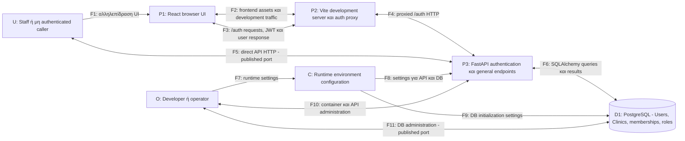
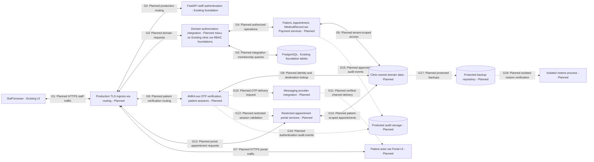

# Μοντέλο Απειλών — med-app

## 1. Στοιχεία εγγράφου και baseline

| Πεδίο | Τιμή |
|---|---|
| Εργασία | SECURITY-00B |
| Έκδοση / ημερομηνία | 1.0 / 2026-10-30 |
| Κατάσταση | Αρχικό μοντέλο απειλών και σχέδιο verification· όχι έγκριση παραγωγής |
| Branch | `feature/clinic-authorization` |
| Baseline commit | `f8ca23d23f5e46db87fe724dbfeea1351738400e` |
| Βάση σχεδιασμού | Ολοκληρωμένη read-only επιθεώρηση SECURITY-00B και στοχευμένη διασταύρωση repository evidence |
| Προδιαγραφή | [System Specification v1.0](../system-specification.md), ιδίως §§5–6, 19–24, 26–27, 31 |
| Απαιτήσεις | [SECURITY-REQUIREMENTS.md](SECURITY-REQUIREMENTS.md), SEC-001 έως SEC-032 |

Οι διαδρομές αρχείων είναι σχετικές προς το repository. Οι ενδείξεις E01–E12 και T01–T11 διατηρούν τη σημασία που έχουν στο SECURITY-REQUIREMENTS.md. Το baseline εκείνου του εγγράφου είναι το προηγούμενο commit επιθεώρησης `985d7567dda50f8967911c0c18a1785433a80a4c`. Το παρόν baseline περιλαμβάνει και το ίδιο το security requirements document.

Η διασταύρωση αφορά κώδικα, tests ως κείμενο και configuration. **Δεν εκτελέστηκαν application tests, migrations, επιθέσεις ή έλεγχος ζωντανής εγκατάστασης κατά τη σύνταξη.** Δεν επιθεωρήθηκαν πραγματικές τιμές μυστικών ή εγκατεστημένες εξαρτήσεις για vulnerabilities. Η ύπαρξη ενός test δεν αποτελεί απόδειξη πρόσφατης επιτυχούς εκτέλεσης ή πλήρους κάλυψης.

## 2. Πεδίο και περιβάλλον χρήσης

Η med-app είναι ακαδημαϊκή εφαρμογή διαχείρισης ιατρείου με στόχο multi-tenant αρχιτεκτονική. Σήμερα επιτρέπονται αποκλειστικά ανάπτυξη και ελεγχόμενη επίδειξη με **συνθετικά δεδομένα**. Πραγματικά δεδομένα ασθενών και δημόσια παραγωγική εγκατάσταση **δεν είναι εξουσιοδοτημένα**.

Η αρχιτεκτονική πρέπει να υποστηρίζει μελλοντική πραγματική χρήση. Οι αντίστοιχες απειλές καταγράφονται προληπτικά. Δεν παρουσιάζονται ως αποδεδειγμένες ευπάθειες endpoints που δεν υπάρχουν ακόμη. Η εισαγωγή πραγματικών δεδομένων απαιτεί ξεχωριστό production-readiness gate, εφαρμογή των σχετικών SEC απαιτήσεων και ρητή νέα έγκριση.

Τα συνθετικά δεδομένα μειώνουν τον αντίκτυπο αποκάλυψης στοιχείων ασθενών. Δεν καταργούν τους κινδύνους κλοπής developer credentials, παραβίασης host, αλλοίωσης λογισμικού ή διακοπής επίδειξης. Αντιγραφή ή απλή ψευδωνυμοποίηση πραγματικού φακέλου δεν θεωρείται συνθετικό dataset.

Η **συμμόρφωση με τον GDPR δεν έχει τεκμηριωθεί**. Το μοντέλο δεν αποτελεί νομική αξιολόγηση, πιστοποίηση ασφάλειας ή penetration test. Privacy/governance εκκρεμότητες παραπέμπονται στις SEC-030 και SEC-031 χωρίς να συνάγεται ότι τα τεχνικά μέτρα αρκούν για συμμόρφωση.

### 2.1 Δεσμευτικές αποφάσεις

- Ο OWNER έχει όλες τις δηλωμένες permissions εντός της δικής του Clinic, ακόμη και `medical_records.read` / `medical_records.write` χωρίς DOCTOR. Πρόκειται για εγκεκριμένη συμπεριφορά. Η κατάχρησή της παραμένει insider risk.
- OWNER και `is_superuser` δεν παρακάμπτουν clinic boundaries.
- Τα roles συνδυάζονται προσθετικά μόνο στην ίδια clinic membership. Ρόλοι διαφορετικών Clinics δεν συνδυάζονται.
- Το clinic context και το RBAC είναι υλοποιημένα foundations, σήμερα ασκούμενα μέσω test-only routes. Δεν υπάρχει resource-level Patient isolation implementation.
- Το μελλοντικό onboarding ευνοεί αρχικό OWNER bootstrap και invitations για DOCTOR/SECRETARY. Πρόκειται για Planned design, όχι σημερινή λειτουργία.

## 3. Μέθοδος STRIDE και ποιοτική αξιολόγηση

Η ανάλυση εξετάζει actors, processes, stores, flows και trust boundaries. Κάθε απειλή συνδέεται με συγκεκριμένο σενάριο, προϋποθέσεις, assets, evidence, SEC απαιτήσεις και προτεινόμενο verification. Πολλαπλές STRIDE κατηγορίες μπορούν να ισχύουν στο ίδιο σενάριο.

| Κατηγορία | Ερώτημα για τη med-app |
|---|---|
| Spoofing (S) | Μπορεί κάποιος να εμφανιστεί ως άλλος staff user ή Patient; |
| Tampering (T) | Μπορεί να αλλοιώσει δεδομένα, συσχετίσεις, permissions ή το λογισμικό; |
| Repudiation (R) | Μπορεί να αρνηθεί ενέργειες ή να καταστρέψει την απόδειξή τους; |
| Information Disclosure (I) | Μπορεί να διαβάσει δεδομένα εκτός του επιτρεπόμενου σκοπού/Clinic; |
| Denial of Service (D) | Μπορεί να εξαντλήσει πόρους ή να εμποδίσει την ανάκτηση λειτουργίας; |
| Elevation of Privilege (E) | Μπορεί να αποκτήσει permissions που δεν του έχουν αποδοθεί στο συγκεκριμένο context; |

### 3.1 Κλίμακες και περιορισμοί ratings

| Διάσταση | Τιμές και ερμηνεία |
|---|---|
| Likelihood | Χαμηλή: ισχυρά υπάρχοντα εμπόδια ή σημαντικές προϋποθέσεις. Μέση: εύλογο σενάριο με πρόσθετο foothold ή αβεβαιότητα. Υψηλή: απλή επανάληψη σε προσβάσιμη επιφάνεια χωρίς επαρκή abuse controls. Άγνωστη: ανεπαρκή στοιχεία. |
| Impact | Χαμηλός: περιορισμένη επίδραση. Μέσος: περιορισμένη έκθεση/διακοπή. Υψηλός: ουσιαστική παραβίαση λογαριασμού, clinic δεδομένων ή λειτουργίας. Κρίσιμος: ευρεία δια-tenant παραβίαση, έλεγχος κρίσιμης υποδομής ή μη ανακτήσιμη καταστροφή. |
| Severity | Χαμηλή, Μέση, Υψηλή, Κρίσιμη: προτεινόμενη συνολική βαρύτητα με βάση impact, προϋποθέσεις και υπαρκτά controls. Δεν προκύπτει από αριθμητικό score. Απειλές ευρείας παραβίασης παραμένουν Κρίσιμες ακόμη με αβέβαιη likelihood. |

Οι likelihood εκτιμήσεις δεν είναι μετρημένες πιθανότητες. Για μελλοντικά features ισχύουν υπό τον ρητό όρο ότι θα υλοποιηθούν με το περιγραφόμενο κενό. Planned controls δεν μειώνουν την αξιολόγηση. Η severity αφορά την υποθετική **μελλοντική παραγωγή με πραγματικά δεδομένα**, με τα ίδια gaps· δεν δηλώνει τρέχον incident ή ισοδύναμο demo impact.

Για να μην συγχέεται η severity με τη σειρά εργασιών, χρησιμοποιούνται ξεχωριστά:

- **Demo Δ0:** έλεγχος έκθεσης, credentials και εξουσιοδοτημένου scope πριν από κάθε επίδειξη. Δεν απαιτείται ολοκλήρωση όλου του production σχεδιασμού.
- **Demo Δ1:** επόμενη βελτίωση/verification του υπάρχοντος foundation σε ελεγχόμενο περιβάλλον.
- **Demo Δ2:** προληπτικός σχεδιασμός πριν παρουσιαστεί η αντίστοιχη μελλοντική λειτουργία· δεν υπάρχει σημερινό endpoint προς εκμετάλλευση.
- **Production P0:** blocker πριν από πραγματικά δεδομένα ή δημόσια παραγωγή.
- **Production P1:** blocker πριν από διάθεση της συγκεκριμένης λειτουργίας· αν περιλαμβάνεται στο release, πρέπει να έχει κλείσει και αυτός.

Οι production προτεραιότητες ακολουθούν τις SEC απαιτήσεις. Οι αποφάσεις αποδοχής κινδύνου δεν παρέχουν τρέχουσα άδεια πραγματικών δεδομένων.

## 4. Υφιστάμενο σύστημα και όρια υλοποίησης

| Component | Τεκμηριωμένη σημερινή κατάσταση |
|---|---|
| React/TypeScript browser UI | Login, current-user state, protected dashboard navigation, local logout. |
| Vite development server | Σερβίρει frontend και κάνει proxy τα `/auth` requests. |
| FastAPI authentication API | Public `/auth/register`, `/auth/login` και protected `/auth/me`. Το registration δημιουργεί User χωρίς clinic membership. |
| FastAPI γενικά endpoints | `/`, public `/health/db` και default documentation/schema routes χωρίς ειδικό περιορισμό στο `main.py`. |
| Security utilities | bcrypt hashing, JWT signing/expiration και validation ταυτότητας. |
| Clinic/RBAC dependencies | Membership lookup, clinic-scoped union permissions και no-superuser-bypass. Δεν αποτελούν αυτόματα προστασία κάθε ORM query. |
| SQLAlchemy/PostgreSQL | Users, Clinics, ClinicMemberships και MembershipRoles με migrations και βασικά constraints. |
| Docker Compose | Development servers, bind mounts και host-published frontend/backend/DB ports. Δεν αποδεικνύεται πραγματική πρόσβαση από εξωτερικό δίκτυο. |

Patient APIs, OTP, application audit logging, rate limiting, production TLS και verified backups **δεν τεκμηριώνονται ως υλοποιημένα**. Persistent volume δεν αποτελεί backup. Default server logging δεν αποτελεί πλήρες audit trail ούτε απόδειξη redaction.

Το `API_PREFIX` υπάρχει στο configuration αλλά δεν εφαρμόζεται στο router inclusion. Οι πραγματικές authentication διαδρομές είναι `/auth/*`. Το login δεν ελέγχει `is_active` πριν εκδώσει token· protected requests το ελέγχουν στη συνέχεια. Δεν υπάρχει server-side logout/revocation implementation. Το local browser logout δεν ακυρώνει αντιγραμμένο token.

## 5. Actors, attackers, assets και ταξινόμηση

| Actor / attacker | Εξουσία ή δυνατότητα που μοντελοποιείται |
|---|---|
| OWNER | Όλες οι δηλωμένες permissions μόνο στη δική του Clinic· πιθανή κατάχρηση νόμιμης πρόσβασης. |
| DOCTOR / SECRETARY | Επιτρεπόμενες ενέργειες του εγκεκριμένου matrix· πιθανός malicious ή compromised staff account. |
| Multi-clinic user | Memberships σε περισσότερες Clinics· πιθανή προσπάθεια role leakage ή resource substitution. |
| Patient — future | Ανεξάρτητη AMKA + OTP identity, μόνο επιτρεπόμενα appointment workflows. |
| Μη authenticated caller | Άμεσες API κλήσεις, enumeration, επανάληψη requests, malformed inputs. |
| Token holder / browser attacker | Αντιγραμμένο bearer token ή script foothold μέσα σε authenticated browser. |
| Network attacker | Παθητική/ενεργή παρέμβαση εφόσον έχει πρόσβαση στο δίκτυο μεταφοράς. |
| Operator / compromised host | Πρόσβαση σε containers, environment, DB και διαθέσιμα logs/αντίγραφα· όχι αυτόματο application role. |
| Dependency / provider attacker | Έλεγχος package/image/build ή μελλοντικού messaging provider. |

| Asset ID | Κατηγορία | Περιεχόμενο και απαιτούμενη προστασία |
|---|---|---|
| A1 | Μυστικά authentication | Passwords, hashes, JWTs και μελλοντικά OTPs/sessions· αποτροπή αντιγραφής, replay και άσκοπης αποκάλυψης. |
| A2 | Μυστικά/ακεραιότητα υποδομής | Signing keys, DB/provider credentials, source, dependencies, images, configuration και host. |
| A3 | Authorization δεδομένα | Users, active status, Clinics, memberships και roles· ακεραιότητα και clinic-local scope. |
| A4 | Ιδιαίτερα ευαίσθητα δεδομένα στόχου | Μελλοντικά medical records, ιστορικό, prescriptions, AMKA και συσχετίσεις περίθαλψης. Σήμερα μόνο συνθετικές αναπαραστάσεις. |
| A5 | Εμπιστευτικά λειτουργικά δεδομένα | Μελλοντικοί Patients, appointments, payments, staff contacts, analytics· clinic isolation και ελαχιστοποίηση. |
| A6 | Δευτερογενή αντίγραφα/evidence | Logs, μελλοντικά audit records, exports και backups· κληρονομούν την ευαισθησία του περιεχομένου. |
| A7 | Διαθεσιμότητα και ακεραιότητα υπηρεσίας | API/DB πόροι, λειτουργία επίδειξης και μελλοντική δυνατότητα ασφαλούς ανάκτησης. |

Metadata ραντεβού, ειδικότητας, reminders ή πληρωμών μπορούν να αποκαλύψουν σχέση με περίθαλψη χωρίς clinical notes. Δημόσια θεωρούνται μόνο ρητά εγκεκριμένα μη ευαίσθητα στοιχεία. Η ταξινόμηση δεν αποτελεί ισχυρισμό ότι υπάρχουν ήδη όλα τα παραπάνω stores/workflows.

## 6. Data-flow diagrams

### 6.1 Υφιστάμενη αρχιτεκτονική

Το διάγραμμα απεικονίζει υλοποιημένα components και τις ροές του development configuration. Δεν αποδεικνύει ότι εκτελούνται σήμερα containers. Τα αμφίδρομα βέλη περιλαμβάνουν request και response.

Το browser flow υλοποιεί `/auth/login` και `/auth/me`. Το `/auth/register` είναι API surface, χωρίς registration UI στο diagram. Το JWT επιστρέφεται στο login και αποστέλλεται ως `Authorization: Bearer ...` στο `/auth/me`.

Το clinic context/RBAC code υπάρχει, αλλά τα routes που το ασκούν είναι test-only. Δεν προστίθεται τεχνητή production clinic-resource ροή στο τρέχον DFD. Τα host-published ports περιγράφουν επιφάνεια έκθεσης· η πραγματική προσβασιμότητα εξαρτάται και από host/network controls. Τα server logs είναι υποστηρικτική έξοδος της λειτουργίας με μη επαληθευμένο περιεχόμενο/retention, όχι ξεχωριστό τεκμηριωμένο audit component.

### 6.2 Μελλοντική αρχιτεκτονική — σχεδιαστική πρόταση

Κάθε νέο component δηλώνεται **Planned** στο label. Όλες οι ροές με IDs G1–G18 είναι μελλοντικές και δηλώνονται Planned, είτε είναι αμφίδρομες είτε έχουν διακεκομμένη γραμμή. Οι υπάρχοντες κόμβοι δηλώνονται Existing· οι νέες production ρυθμίσεις τους δεν θεωρούνται υλοποιημένες. Πρόκειται για λογικές λειτουργίες και stores, όχι απόφαση για ανεξάρτητα microservices ή επιλεγμένο provider.

Στο παραπάνω διάγραμμα τα αμφίδρομα G1–G9, G13–G14 είναι επίσης **Planned**, όπως αναγράφεται στα labels· η αμφίδρομη σημειογραφία δεν σημαίνει υλοποιημένη ροή. Η διάκριση staff/patient validation δεν επιτρέπει σε patient session να αποκτήσει staff authority. Η εγκεκριμένη πρόσβαση OWNER δεν εκτείνεται σε άλλη Clinic.

Το H μπορεί να υλοποιηθεί στην ίδια PostgreSQL με το D με λογική απομόνωση· δύο κόμβοι δεν υπονοούν δύο physical databases. Το G12 παριστάνει τον έλεγχο εξουσίας της patient session, όχι παράκαμψη των HTTP requests ή αποστολή OTP σε staff validator. Provider receipts, reminders, exports και analytics χρειάζονται λεπτομερέστερο DFD όταν σχεδιαστούν. Staff/audit και foundation DB backup κάλυψη πρέπει επίσης να εξειδικευθούν πριν την παραγωγή· το μελλοντικό DFD δεν αποτελεί πλήρες deployment design.

## 7. Trust boundaries και attack surfaces

| ID | Boundary | Ροές / εφαρμογή |
|---|---|---|
| B1 | Browser ή άμεσος caller → API | F3–F5, G1–G3, G7–G8, G13· όλα τα client inputs είναι μη έμπιστα. |
| B2 | Bearer token → current database identity | F4/F6 και μελλοντικά G2· η υπογραφή δεν αποδεικνύει ενεργή κατάσταση ή membership. |
| B3 | User → Clinic → permission | Υλοποιημένο dependency μέσω test-only routes· μελλοντική production integration G3–G5. |
| B4 | Clinic permission → resource / relationship | Μελλοντικά G4/G6/G14· membership μόνο του δεν αρκεί για object access. |
| B5 | Staff identity → Patient identity | Μελλοντικά G8/G12/G13· διαφορετικό authentication/authorization scope. |
| B6 | Application → DB | F6, G5/G6/G9/G14· privileges, query safety, integrity. |
| B7 | Host/network/operator → containers και configuration | F5/F7–F11· πραγματική πρόσβαση δεν έχει ελεγχθεί. |
| B8 | Runtime → logs/audit/exports/backups | Logs του σημερινού setup, μελλοντικά G15–G18 και exports. |
| B9 | Application → messaging provider / contact | Μελλοντικά G10/G11· destination ownership και provider trust. |
| B10 | Development/demo → production | Αλλαγή scope, ingress, configuration, governance και ρητή έγκριση. |

Η Clinic είναι λογικό όριο εξουσιοδότησης. Δεν τεκμαίρονται ξεχωριστά δίκτυα/DB ανά tenant ή database row-level security.

| Επιφάνεια | Τρέχουσα κατάσταση / κίνδυνος |
|---|---|
| Authentication endpoints | Registration JSON, login form fields, bearer parsing· public registration/login. |
| General endpoints | Root, DB health, default docs/schema· χρειάζεται approved public allowlist. |
| Browser / proxy | State, user rendering, request headers και `/auth` proxy. UI guards δεν είναι API protection. |
| Deployment | Published ports, development servers, bind mounts, image build contexts και environment. |
| Supply chain | Requirements/manifests, lockfile, base images και package resolution. Δεν έγινε vulnerability scan. |
| Future domain | Resource IDs, clinic IDs, links, bulk operations, search, exports και analytics. |
| Future identity/operations | Invitations, recovery, AMKA/OTP, reminders, audit access και backup/restore. |

## 8. Υπάρχοντα controls και repository evidence

| Control | Evidence | Πεδίο και όριο αποτελεσματικότητας |
|---|---|---|
| C1 — Password/JWT foundation | [security.py](../../backend/app/core/security.py), [config.py](../../backend/app/core/config.py), T01 | bcrypt, signed JWT, required `sub`/`exp`, subject bounds, configured algorithm. Το επιτυχές login test κάνει mock το password verification. Δεν υπάρχει πλήρης approved password/session policy. |
| C2 — Current user | [deps.py](../../backend/app/api/deps.py), T02/T03 | Lookup τρέχοντος User, inactive denial και 401 credentials. Δεν εμποδίζει έκδοση inactive-user token στο login. |
| C3 — Clinic/RBAC foundation | `deps.py`, [permissions.py](../../backend/app/core/permissions.py), T04/T05/T06 | Clinic-local membership/roles, ισοδύναμα inaccessible/nonexistent 404, no-superuser-bypass. Tests μέσω test-only routes, όχι Patient APIs. |
| C4 — DB integrity foundation | [Membership model](../../backend/app/db/models/clinic_membership.py), [Role model](../../backend/app/db/models/membership_role.py), [DB session](../../backend/app/db/session.py), E10, T07 | FKs, uniqueness, enum και ORM queries. Όχι tenant consistency μελλοντικών domain relationships ή αποδεδειγμένο least privilege. |
| C5 — Browser auth state | [AuthProvider](../../frontend/src/auth/AuthProvider.tsx), [ProtectedRoute](../../frontend/src/auth/ProtectedRoute.tsx), T08/T11 | Memory-only token/state, local logout, stale-response handling. Όχι server revocation ή προστασία από malicious script. |
| C6 — Output handling | [User schema](../../backend/app/schemas/user.py), [API client](../../frontend/src/api/client.ts), [LoginPage](../../frontend/src/pages/LoginPage.tsx), T03/T09/T10 | Hash εκτός user response, σταθερά UI error messages. Όχι πλήρης backend/log redaction ή ασφαλές export design. |
| C7 — Configuration foundation | `config.py`, [.env.example](../../.env.example), [.gitignore](../../.gitignore) | Environment-based settings και απαιτούμενο signing secret με minimum length. Όχι απόδειξη entropy, safe production defaults, rotation ή πλήρους secret exclusion. |

Πρόσθετα evidence: [auth.py](../../backend/app/api/auth.py), [main.py](../../backend/app/main.py), [frontend auth client](../../frontend/src/api/auth.ts), [Vite config](../../frontend/vite.config.ts), [Compose](../../docker-compose.yml), [Backend Dockerfile](../../backend/Dockerfile), [Frontend Dockerfile](../../frontend/Dockerfile), [Backend requirements](../../backend/requirements.txt), [Frontend manifest](../../frontend/package.json).

Το development setup έχει HTTP, reload/Vite servers, published DB/API ports και δεν δηλώνει non-root container user. Δεν βρέθηκαν production TLS/backup runbooks ή limiter/audit implementations στο evidence baseline. Το αν εξωτερικά firewalls, host encryption ή άλλα operational controls εφαρμόζονται παραμένει Unknown.

## 9. Threat register

Κάθε καταχώριση είναι σενάριο κινδύνου, όχι αναφορά επιτυχούς exploit. Οι ενδείξεις «κενό κώδικα» αφορούν παρατηρημένη υλοποίηση. Οι όροι «μελλοντικό» και «υπό προϋποθέσεις» διατηρούν τη διάκριση από αποδεδειγμένη σημερινή ευπάθεια.

### TM-001 — Κατάληψη staff account

- **STRIDE / κατάσταση:** Spoofing (S) · Τρέχουσα επιφάνεια, μη εκτελεσμένο attack scenario.
- **Attacker / προϋποθέσεις:** Caller με network access στο `/auth/login` και λίστα γνωστών ή επαναχρησιμοποιημένων passwords.
- **Σενάριο:** Επαναλαμβάνει credential guesses μέχρι να αποκτήσει token ενεργού staff user.
- **Assets / boundaries / flows:** A1/A3 και μελλοντικά A4/A5· B1/B2· F4/F5/F6.
- **Impact:** Υψηλός· πρόσβαση με την ταυτότητα και τις permissions του θύματος. Στο demo κυρίως account/infrastructure και λειτουργική επίδραση.
- **Likelihood / severity:** Υψηλή εάν προσβάσιμο σε μη έμπιστους callers, χαμηλότερη σε απομονωμένο demo· απλή επανάληψη χωρίς limiter. Severity Υψηλή.
- **Υπάρχοντα controls:** C1 hashing, κοινό login error και C2 στα protected requests.
- **Ελλείποντα controls:** Εγκεκριμένη password policy, throttling, authentication monitoring, MFA απόφαση και πλήρη failed-login/real-hashing tests.
- **Demo / production priority:** Δ0 για περιορισμό πρόσβασης, Δ1 για hardening · P0.
- **SEC IDs:** SEC-002, SEC-004, SEC-005, SEC-020, SEC-029.
- **Προτεινόμενο verification:** Wrong/unknown credentials, πραγματικό hash/verify, byte boundaries, εγκεκριμένα account/IP limits και ασφαλή failure logs. Δεν εκτελέστηκαν εδώ.

### TM-002 — Replay αντιγραμμένου JWT μετά το logout

- **STRIDE / κατάσταση:** Spoofing (S) · Τρέχον παρατηρημένο session gap, όχι δοκιμασμένο exploit.
- **Attacker / προϋποθέσεις:** Κάτοχος αντιγραμμένου μη ληγμένου token ενεργού User.
- **Σενάριο:** Επαναχρησιμοποιεί το token μετά το local logout του νόμιμου χρήστη.
- **Assets / boundaries / flows:** A1/A3 και μελλοντικά A4/A5· B1/B2· F3–F6.
- **Impact:** Υψηλός· διατήρηση πρόσβασης στο παράθυρο αποδοχής του token.
- **Likelihood / severity:** Μέση, επειδή απαιτεί προηγούμενη απόκτηση token· η απουσία revocation διατηρεί το σενάριο εύλογο. Severity Υψηλή.
- **Υπάρχοντα controls:** C1 expiration, C2 current active-user lookup, C5 local clearing. Deactivation απορρίπτεται σε protected requests.
- **Ελλείποντα controls:** Εγκεκριμένη revocation/logout/credential-change πολιτική και replay verification. Inactive-user login μπορεί να εκδώσει token, αλλά δεν παρακάμπτει το protected active check.
- **Demo / production priority:** Δ0 για μη διαμοιρασμό credentials/tokens, Δ1 για policy/tests · P0.
- **SEC IDs:** SEC-003, SEC-006, SEC-007, SEC-008.
- **Προτεινόμενο verification:** Αντιγραμμένο token πριν/μετά logout, expiry, deactivation και credential change έναντι της εγκεκριμένης πολιτικής· inactive login denial test.

### TM-003 — Πλαστογράφηση identity μετά από compromise signing key

- **STRIDE / κατάσταση:** Spoofing (S), Elevation of Privilege (E) · Τρέχουσα εξάρτηση από secret custody, υπό προϋποθέσεις.
- **Attacker / προϋποθέσεις:** Πρόσβαση σε leaked ή προβλέψιμο signing key και γνώση υπάρχοντος user ID.
- **Σενάριο:** Δημιουργεί υπογεγραμμένο token για ενεργό User, ενδεχομένως OWNER.
- **Assets / boundaries / flows:** A1/A2/A3 και μελλοντικά A4/A5· B2/B7· F7/F8 και F4–F6.
- **Impact:** Κρίσιμος· πλαστογράφηση πολλών ταυτοτήτων και ευρεία πρόσβαση μέσω των αντίστοιχων memberships. Η ισχύς του token δεν καταργεί τα membership checks.
- **Likelihood / severity:** Μέση με σημαντική αβεβαιότητα· entropy/custody πραγματικού key δεν επιθεωρήθηκαν. Severity Κρίσιμη.
- **Υπάρχοντα controls:** C1 signature validation, C2 current identity, C7 required secret/minimum length.
- **Ελλείποντα controls:** Placeholder/entropy policy, περιορισμένη custody, rotation, key-compromise response και production validation.
- **Demo / production priority:** Δ0 για secrets και build contexts · P0.
- **SEC IDs:** SEC-006, SEC-023, SEC-029.
- **Προτεινόμενο verification:** Settings failure cases χωρίς εκτύπωση μυστικών, secret exclusion review και rotation exercise με rejection παλιών tokens σύμφωνα με policy.

### TM-004 — Υποκλοπή ή αλλοίωση δικτυακής επικοινωνίας

- **STRIDE / κατάσταση:** Spoofing (S), Information Disclosure (I), Tampering (T) · Deployment-dependent, χωρίς live-network verification.
- **Attacker / προϋποθέσεις:** Θέση παρατήρησης/παρέμβασης σε μη έμπιστο δίκτυο όπου διέρχεται development HTTP.
- **Σενάριο:** Υποκλέπτει password/token ή αλλοιώνει traffic και frontend περιεχόμενο.
- **Assets / boundaries / flows:** A1/A2/A3 και future data· B1/B7/B10· F2–F5, μελλοντικά G1/G2/G7.
- **Impact:** Υψηλός· identity compromise και αλλοίωση ενεργειών/αποτελεσμάτων.
- **Likelihood / severity:** Μέση εφόσον HTTP διασχίζει μη έμπιστο δίκτυο· άγνωστη πραγματική topology. Severity Υψηλή.
- **Υπάρχοντα controls:** Δεν τεκμηριώνεται transport protection στο repository· υπογραφές JWT δεν κρυπτογραφούν το HTTP.
- **Ελλείποντα controls:** Verified TLS ingress, proxy trust, certificate handling και production transport policy.
- **Demo / production priority:** Δ0 για topology/έκθεση και αποφυγή untrusted-network HTTP · P0.
- **SEC IDs:** SEC-024, SEC-025, SEC-026.
- **Προτεινόμενο verification:** Deployment/network review, HTTPS/HTTP behavior και proxy/header checks στο μελλοντικό εγκεκριμένο περιβάλλον.

### TM-005 — Πρόσβαση σε Patient άλλης Clinic

- **STRIDE / κατάσταση:** Information Disclosure (I), Tampering (T), Elevation of Privilege (E) · Μελλοντική design threat· Patient APIs δεν υπάρχουν.
- **Attacker / προϋποθέσεις:** Έγκυρος χρήστης Clinic A και μελλοντικό endpoint χωρίς επαρκές resource scope.
- **Σενάριο:** Αντικαθιστά Patient ID με ID Clinic B για read/update/delete ή εξάγει δεδομένα μέσω search/list/export.
- **Assets / boundaries / flows:** A4/A5· B3/B4/B6· G3–G6.
- **Impact:** Κρίσιμος· δια-tenant έκθεση ή αλλοίωση ιατρικών/λειτουργικών δεδομένων.
- **Likelihood / severity:** Μέση υπό τον όρο ότι παραλειφθεί object scoping· όχι εκτιμώμενη σημερινή exploitability. Severity Κρίσιμη.
- **Υπάρχοντα controls:** C3 membership foundation μόνο, όχι Patient isolation.
- **Ελλείποντα controls:** Tenant-scoped queries, resource ownership checks, tenant-consistent relationships και negative tests όλων των operations.
- **Demo / production priority:** Δ2 πριν παρουσιαστούν Patients · P0.
- **SEC IDs:** SEC-010, SEC-012, SEC-018, SEC-032.
- **Προτεινόμενο verification:** Two-clinic CRUD/list/search/bulk/export/analytics tests με OWNER και multi-clinic χρήστη, χωρίς cross-tenant δεδομένα ή mutations.

### TM-006 — Συνδυασμός roles από άλλη Clinic ή bypass

- **STRIDE / κατάσταση:** Elevation of Privilege (E) · Foundation regression/integration risk, όχι εντοπισμένο bypass.
- **Attacker / προϋποθέσεις:** User με OWNER στην A και SECRETARY στην B, ή `is_superuser=True`.
- **Σενάριο:** Επιχειρεί OWNER operation στην B χρησιμοποιώντας role της A ή ζητά παράκαμψη membership.
- **Assets / boundaries / flows:** A3 και future A4/A5· B3/B4· G3–G5, σήμερα test-only dependency flows.
- **Impact:** Υψηλός· μη εγκεκριμένη clinic authority.
- **Likelihood / severity:** Χαμηλή μέσω των επιθεωρημένων dependencies λόγω ρητών checks/tests· αβέβαιη σε μελλοντική integration. Severity Υψηλή λόγω συνεπειών regression.
- **Υπάρχοντα controls:** C3: clinic-local union, empty-role denial, no-superuser-bypass και same-JWT role changes.
- **Ελλείποντα controls:** Συνεπής production endpoint integration και role/tenant regression tests ανά νέα λειτουργία.
- **Demo / production priority:** Δ1 για foundation verification, Δ2 για domain integration · P0.
- **SEC IDs:** SEC-009, SEC-010, SEC-011, SEC-012, SEC-013, SEC-032.
- **Προτεινόμενο verification:** Ακριβές matrix, swapped contexts, cross-clinic roles, membership removal και superuser denial σε κάθε νέο endpoint.

### TM-007 — Μη εξουσιοδοτημένο provisioning ή role assignment

- **STRIDE / κατάσταση:** Elevation of Privilege (E), Tampering (T) · Τρέχον registration surface και μελλοντικό invitation/role design.
- **Attacker / προϋποθέσεις:** Anonymous registrant ή staff caller με πρόσβαση σε μελλοντικό ελαττωματικό invitation/role-management flow.
- **Σενάριο:** Καταχράται public registration ή μεταβάλλει invitation target/Clinic/role για να αποκτήσει μη εγκεκριμένη membership.
- **Assets / boundaries / flows:** A3/A7 και μελλοντικά A4/A5· B1/B3/B6· F5/F6 και future onboarding extension των G3–G5.
- **Impact:** Υψηλός στο μελλοντικό role-assignment σενάριο· στο σημερινό registration κυρίως account/resource abuse, όχι αποδεδειγμένη clinic πρόσβαση.
- **Likelihood / severity:** Μέση για public registration abuse εφόσον reachable· άγνωστη για μη υλοποιημένο invitation flow. Severity Υψηλή συνολικά για future privilege assignment.
- **Υπάρχοντα controls:** C4 integrity constraints· σημερινό registration δεν αποδίδει membership ή roles.
- **Ελλείποντα controls:** Approved bootstrap/invitations, authorization/activation lifecycle και assignment tests.
- **Demo / production priority:** Δ1 για registration scope, Δ2 πριν onboarding · P0.
- **SEC IDs:** SEC-001, SEC-003, SEC-011, SEC-018, SEC-021.
- **Προτεινόμενο verification:** Unauthorized role/Clinic selection, invitation replay/expiry και bootstrap authority tests, μαζί με audit events.

### TM-008 — Clinical endpoint χωρίς κατάλληλο permission check

- **STRIDE / κατάσταση:** Elevation of Privilege (E), Information Disclosure (I) · Μελλοντική threat, χωρίς clinical APIs στο baseline.
- **Attacker / προϋποθέσεις:** SECRETARY χωρίς clinical role στην αιτούμενη Clinic και endpoint που ελέγχει μόνο authentication/membership.
- **Σενάριο:** Καλεί clinical read/write endpoint απευθείας ή αποκτά medical fields από διοικητικό response.
- **Assets / boundaries / flows:** A4/A5· B3/B4· G3/G4/G6.
- **Impact:** Υψηλός· αποκάλυψη ή αλλοίωση clinical content.
- **Likelihood / severity:** Μέση αν παραλειφθεί endpoint/field-level integration· δεν υπάρχει σημερινό exploit evidence. Severity Υψηλή.
- **Υπάρχοντα controls:** C3 αρνείται clinical permissions σε SECRETARY στο policy level.
- **Ελλείποντα controls:** Clinical endpoint/response-field enforcement και negative tests.
- **Demo / production priority:** Δ2 πριν clinical demo · P0.
- **SEC IDs:** SEC-009, SEC-011, SEC-013, SEC-019, SEC-032.
- **Προτεινόμενο verification:** SECRETARY denied, DOCTOR και OWNER-only allowed εντός Clinic, όλοι denied εκτός Clinic· έλεγχος sensitive fields. OWNER clinical access εντός Clinic δεν χαρακτηρίζεται vulnerability.

### TM-009 — Αλλοίωση query ή cross-clinic relationship

- **STRIDE / κατάσταση:** Tampering (T) · Μελλοντική domain threat· δεν εντοπίστηκε SQL-injection path στον επιθεωρημένο κώδικα.
- **Attacker / προϋποθέσεις:** Caller με mutation permission και μελλοντικό endpoint χωρίς έλεγχο linked objects ή ασφαλή query construction.
- **Σενάριο:** Συνδέει appointment Clinic A με Patient/doctor Clinic B ή εισάγει input σε μη παραμετροποιημένο query.
- **Assets / boundaries / flows:** A4/A5· B4/B6· G4/G6/G14.
- **Impact:** Υψηλός· ασυνεπείς σχέσεις, αλλοίωση records και πιθανή tenant διαρροή.
- **Likelihood / severity:** Μέση εφόσον λείπουν relationship invariants/query safeguards στο νέο feature. Severity Υψηλή.
- **Υπάρχοντα controls:** C4 ORM και membership/role constraints· δεν καλύπτουν ανύπαρκτα domain relationships.
- **Ελλείποντα controls:** Tenant-consistent domain constraints, service validation και query review.
- **Demo / production priority:** Δ2 πριν domain mutations · P0.
- **SEC IDs:** SEC-012, SEC-017, SEC-018.
- **Προτεινόμενο verification:** Cross-clinic FK substitution tests, transaction integrity checks και review ότι untrusted inputs δεν συνενώνονται σε SQL.

### TM-010 — Άρνηση ευθύνης για sensitive ενέργειες

- **STRIDE / κατάσταση:** Repudiation (R) · Μελλοντικά domain workflows με σημερινό κενό audit foundation.
- **Attacker / προϋποθέσεις:** Staff με νόμιμη ή compromised πρόσβαση, συμπεριλαμβανομένου OWNER.
- **Σενάριο:** Μεταβάλλει record/payment/appointment και αρνείται την πράξη ή τον σκοπό πρόσβασης. OWNER μπορεί να καταχραστεί εγκεκριμένη clinical πρόσβαση χωρίς να παρακάμψει permissions.
- **Assets / boundaries / flows:** A3/A4/A5/A6· B4/B8· G4/G6/G15.
- **Impact:** Υψηλός· δυσκολία απόδοσης ευθύνης, αποκατάστασης και διερεύνησης insider misuse.
- **Likelihood / severity:** Μέση· λείπει application audit trail και η εξουσιοδότηση δεν αποδεικνύει νόμιμο σκοπό κάθε ενέργειας. Severity Υψηλή.
- **Υπάρχοντα controls:** C2 identity foundation, ορισμένα creation timestamps· όχι πλήρες attribution.
- **Ελλείποντα controls:** Event catalogue, actor/Clinic/action/outcome attribution, access auditing και προστατευμένο retention.
- **Demo / production priority:** Δ2 για domain evidence, καταγραφή demo limitations · P0.
- **SEC IDs:** SEC-021, SEC-029, SEC-032.
- **Προτεινόμενο verification:** Audit-event tests για mutations, sensitive reads/exports όπου εγκριθούν, actor/Clinic binding και disclosure policy για OWNER access.

### TM-011 — Διαγραφή ή αλλοίωση investigation evidence

- **STRIDE / κατάσταση:** Repudiation (R), Tampering (T) · Operational threat, υπό privileged-compromise προϋπόθεση.
- **Attacker / προϋποθέσεις:** Compromised host/operator ή identity με υπερβολική πρόσβαση στα logs/future audit store.
- **Σενάριο:** Αφαιρεί ή αλλοιώνει evidence μετά από μη εξουσιοδοτημένες ενέργειες.
- **Assets / boundaries / flows:** A2/A6· B7/B8· F10/F11, μελλοντικά G15/G16.
- **Impact:** Υψηλός· απώλεια αξιοπιστίας της διερεύνησης και παρατεταμένο incident.
- **Likelihood / severity:** Μέση υπό privileged compromise· πραγματική log custody άγνωστη. Severity Υψηλή.
- **Υπάρχοντα controls:** Δεν τεκμηριώνεται tamper-protected application audit control.
- **Ελλείποντα controls:** Διαχωρισμός πρόσβασης, integrity/retention protection, evidence preservation και incident διαδικασία.
- **Demo / production priority:** Δ1 για operator access/evidence handling · P0.
- **SEC IDs:** SEC-021, SEC-022, SEC-029.
- **Προτεινόμενο verification:** Unauthorized audit update/delete denial, integrity detection και tabletop με διαφύλαξη evidence χωρίς sensitive leakage.

### TM-012 — Enumeration staff accounts ή Patients

- **STRIDE / κατάσταση:** Information Disclosure (I) · Τρέχον registration feedback και μελλοντικό AMKA lookup.
- **Attacker / προϋποθέσεις:** Caller με λίστα email ή μελλοντικών AMKA inputs και endpoint access.
- **Σενάριο:** Χρησιμοποιεί duplicate-email responses ή διαφορές χρόνου/portal responses για να διαπιστώσει ύπαρξη λογαριασμού ή σχέση Patient–Clinic.
- **Assets / boundaries / flows:** A3 και future A4/A5· B1/B5/B9· F5/F6, G7–G11.
- **Impact:** Υψηλός για future patient association disclosure· πιο περιορισμένος για σημερινά συνθετικά staff στοιχεία.
- **Likelihood / severity:** Υψηλή για reachable duplicate-registration response· future portal likelihood εξαρτάται από το design. Timing leakage δεν μετρήθηκε. Severity Υψηλή στο future scope.
- **Υπάρχοντα controls:** Κοινό login failure text, C3 ισοδύναμα Clinic 404· δεν διορθώνουν duplicate-email feedback.
- **Ελλείποντα controls:** Enumeration-safe onboarding/portal policy, timing assessment και throttling.
- **Demo / production priority:** Δ1 για σημερινό feedback, Δ2 για portal · P0.
- **SEC IDs:** SEC-004, SEC-016, SEC-020.
- **Προτεινόμενο verification:** Known/unknown identifiers με ίδια public semantics, εγκεκριμένη timing μέθοδος και no-sensitive-response tests.

### TM-013 — Sensitive leakage σε responses, logs ή exports

- **STRIDE / κατάσταση:** Information Disclosure (I) · Τρέχον error/logging risk και future clinical/export risk, χωρίς επιβεβαιωμένη leakage εκτέλεση.
- **Attacker / προϋποθέσεις:** Caller που προκαλεί errors ή recipient με πρόσβαση σε υπερβολικά responses/logs/reminders/exports.
- **Σενάριο:** Αποκτά credentials, AMKA, clinical content ή cross-clinic metadata από δευτερογενές κανάλι.
- **Assets / boundaries / flows:** A1/A4/A5/A6· B1/B8/B9· F3–F6, G6/G10/G11/G15/G16 και μελλοντικά exports.
- **Impact:** Υψηλός· ανεξέλεγκτη έκθεση δεδομένων πέρα από το κανονικό authorization path.
- **Likelihood / severity:** Μέση· backend redaction/log contents δεν έχουν συστηματικά επαληθευθεί. Severity Υψηλή.
- **Υπάρχοντα controls:** C6 user schema και safe UI messages. Error detail εξακολουθεί να υπάρχει ως client error data· δεν τεκμαίρεται ασφαλές για logging.
- **Ελλείποντα controls:** Backend sanitization, captured-log tests, export scope, minimization και retention.
- **Demo / production priority:** Δ0 για credentials/screenshots/logs, Δ2 για exports · P0.
- **SEC IDs:** SEC-012, SEC-019, SEC-021, SEC-022, SEC-030.
- **Προτεινόμενο verification:** DB/validation/concurrent-registration failures, log captures και response/export schemas χωρίς secrets, περιττά fields ή tenant leakage.

### TM-014 — Malicious script σε authenticated browser

- **STRIDE / κατάσταση:** Spoofing (S), Information Disclosure (I), Tampering (T) · Conditional threat· δεν εντοπίστηκε XSS exploit.
- **Attacker / προϋποθέσεις:** Injection foothold σε μελλοντικό unsafe rendering ή compromise frontend dependency/asset delivery.
- **Σενάριο:** Script ενεργεί μέσα στον authenticated browser, παρατηρεί διαθέσιμα δεδομένα ή παρεμβαίνει σε requests.
- **Assets / boundaries / flows:** A1/A4/A5/A2· B1/B7· F2/F3 και future G1/G3.
- **Impact:** Υψηλός· session-assisted πρόσβαση και αλλοίωση λειτουργιών.
- **Likelihood / severity:** Μέση εφόσον υπάρξει script foothold· σημερινή εκμεταλλευσιμότητα δεν έχει αποδειχθεί. Severity Υψηλή.
- **Υπάρχοντα controls:** C5 memory-only state, React rendering, C6 safe messages· δεν αποτελούν πλήρη XSS άμυνα.
- **Ελλείποντα controls:** Verified CSP/headers/origin policy, unsafe-rendering verification και dependency assurance.
- **Demo / production priority:** Δ1 για browser/dependencies, Δ0 αν assets διασχίζουν μη έμπιστο δίκτυο · P1 πριν τη διάθεση των σχετικών browser flows, υποχρεωτικό για όσα περιλαμβάνονται στην παραγωγή.
- **SEC IDs:** SEC-008, SEC-025, SEC-027.
- **Προτεινόμενο verification:** Untrusted text rendering, no-token DOM/storage/URL assertions, production header checks και dependency/build review.

### TM-015 — Εξάντληση authentication/API πόρων

- **STRIDE / κατάσταση:** Denial of Service (D) · Τρέχουσα επιφάνεια χωρίς τεκμηριωμένα abuse controls.
- **Attacker / προϋποθέσεις:** Caller που μπορεί να στείλει επαναλαμβανόμενα ή υπερμεγέθη requests.
- **Σενάριο:** Επαναλαμβάνει hashing μέσω registration/login, διογκώνει inputs ή καλεί DB health για να καταναλώσει API/DB πόρους.
- **Assets / boundaries / flows:** A7/A2· B1/B6/B7· F4/F5/F6.
- **Impact:** Υψηλός· διακοπή υπηρεσίας/επίδειξης ή υπερκατανάλωση πόρων.
- **Likelihood / severity:** Υψηλή αν reachable σε untrusted callers· απλή επανάληψη χωρίς limiter. Δεν μετρήθηκε capacity ή πραγματικό DoS. Severity Υψηλή.
- **Υπάρχοντα controls:** Περιορισμένη schema/path validation και C4 uniqueness· όχι rate limiting.
- **Ελλείποντα controls:** Request bounds, quotas/throttles, resource limits και production capacity policy.
- **Demo / production priority:** Δ0 για περιορισμό έκθεσης, Δ1 για limits · P0.
- **SEC IDs:** SEC-017, SEC-020, SEC-026.
- **Προτεινόμενο verification:** Εγκεκριμένα boundary/concurrency tests σε απομονωμένο test περιβάλλον· όχι ανεξέλεγκτο load σε developer/production DB.

### TM-016 — Κλοπή, καταστροφή ή μη ανακτήσιμη απώλεια DB

- **STRIDE / κατάσταση:** Information Disclosure (I), Tampering (T), Denial of Service (D) · Operational/deployment-dependent.
- **Attacker / προϋποθέσεις:** Πρόσβαση σε DB/host credentials ή εκτεθειμένη DB· η απώλεια μπορεί επίσης να προκύψει από λειτουργική αστοχία, όχι μόνο επίθεση.
- **Σενάριο:** Κάνει bulk read/delete μέσω excessive privileges ή καταστρέφει το volume χωρίς διαθέσιμο verified restore.
- **Assets / boundaries / flows:** A2/A3/A4/A5/A6/A7· B6/B7/B8· F6/F11, G17/G18.
- **Impact:** Κρίσιμος· ευρεία έκθεση/αλλοίωση ή μη ανακτήσιμη απώλεια.
- **Likelihood / severity:** Μέση με αβεβαιότητα· live exposure, runtime privileges και host protection άγνωστα. Severity Κρίσιμη.
- **Υπάρχοντα controls:** C4 constraints και persistent volume· κανένα δεν αποδεικνύει ασφαλές backup ή recovery.
- **Ελλείποντα controls:** Network restrictions, least-privilege runtime/migration roles, encryption/key custody, backups και tested restores.
- **Demo / production priority:** Δ0 για DB έκθεση/credentials και ανακτήσιμο συνθετικό demo setup · P0.
- **SEC IDs:** SEC-018, SEC-023, SEC-026, SEC-028, SEC-029.
- **Προτεινόμενο verification:** Deployment/privilege review και απομονωμένο restore με integrity/tenant checks και εγκεκριμένα RPO/RTO πριν real data.

### TM-017 — Compromise dependency, image ή build

- **STRIDE / κατάσταση:** Tampering (T), Elevation of Privilege (E) · Τρέχουσα supply-chain εξάρτηση, υπό προϋποθέσεις.
- **Attacker / προϋποθέσεις:** Έλεγχος package/image/build ή δυνατότητα εισαγωγής μη έμπιστης dependency/artifact.
- **Σενάριο:** Κακόβουλος κώδικας εκτελείται με application/container access, διαβάζει keys ή αλλοιώνει συμπεριφορά.
- **Assets / boundaries / flows:** A2/A1 και future A4/A5· B7/B10· build/configuration που επηρεάζει F2/F8/F10.
- **Impact:** Κρίσιμος· runtime compromise και δυνατότητα επέκτασης σε identities/δεδομένα.
- **Likelihood / severity:** Μέση/αβέβαιη χωρίς dependency audit ή build verification. Severity Κρίσιμη.
- **Υπάρχοντα controls:** Frontend lockfile και ορισμένα version constraints· όχι πλήρης reproducible/hardened build απόδειξη.
- **Ελλείποντα controls:** Συνεπές dependency resolution, vulnerability review, image hardening, ελεγμένο build context και remediation policy.
- **Demo / production priority:** Δ0 για secrets στα artifacts, Δ1 για dependency/build review · P0 για secrets/hardening, P1 για dependency release assurance.
- **SEC IDs:** SEC-023, SEC-026, SEC-027.
- **Προτεινόμενο verification:** Reproducible build review, καταγεγραμμένο scan και επιβεβαίωση ότι secrets δεν περιλαμβάνονται σε images/bundles. Δεν δηλώνεται γνωστή ευπάθεια συγκεκριμένου package.

### TM-018 — Patient impersonation ή σύγχυση portal/staff session

- **STRIDE / κατάσταση:** Spoofing (S), Elevation of Privilege (E) · Μελλοντική design threat· OTP/portal δεν υλοποιούνται σήμερα.
- **Attacker / προϋποθέσεις:** Πρόσβαση σε OTP request/verify flow, λάθος contact binding ή patient session που γίνεται δεκτή σε λάθος validator.
- **Σενάριο:** Μαντεύει/επαναχρησιμοποιεί OTP, παραλαμβάνει code άλλου Patient ή παρουσιάζει patient session σε staff API.
- **Assets / boundaries / flows:** A1/A4/A5· B1/B5/B9/B4· G7–G14.
- **Impact:** Υψηλός· πρόσβαση ή αλλαγή ξένων appointments και πιθανή staff privilege escalation αν αποτύχει identity separation.
- **Likelihood / severity:** Μέση υπό ελαττωματική μελλοντική υλοποίηση· σημερινή operational likelihood δεν εφαρμόζεται. Severity Υψηλή.
- **Υπάρχοντα controls:** Κανένα implemented OTP/portal control. Η προδιαγραφή προβλέπει διαχωρισμό αλλά δεν αποτελεί runtime άμυνα.
- **Ελλείποντα controls:** Destination verification, entropy/expiry, atomic single-use, attempts/resend limits, distinct validation και patient/clinic appointment scope.
- **Demo / production priority:** Δ2 πριν Portal demo · P1 πριν Portal release, μαζί με P0 abuse/tenant controls.
- **SEC IDs:** SEC-014, SEC-015, SEC-016, SEC-020, SEC-032.
- **Προτεινόμενο verification:** OTP expiry/replay/concurrent redemption, wrong destination/patient/Clinic, staff-token confusion denial και αποκλεισμός medical records.

## 10. Προτεραιοποιημένα mitigations και verification plan

| Στάδιο | Προτεραιότητα / ενέργεια στόχου | Threats / απαιτούμενη evidence |
|---|---|---|
| Πριν κάθε synthetic demo | Επιβεβαίωση synthetic-only dataset/screenshots/exports/logs, πραγματικής topology/port exposure και προστασίας credentials. Καμία public production χρήση. | TM-003, TM-004, TM-013, TM-015–TM-017· configuration/network review και καταγραφή γνωστών περιορισμών. |
| Επόμενη foundation εργασία | Password/login state, failed-login tests, session/replay policy, registration/onboarding scope και εγκεκριμένα request/throttle limits. | TM-001, TM-002, TM-007, TM-012, TM-015· πραγματικά hash/verify και negative auth/abuse tests. |
| Πριν Patient/clinical features | Tenant-scoped queries/relationships, consistent dependency integration και field-level clinical policy. OWNER παραμένει πλήρως εξουσιοδοτημένος μόνο εντός Clinic. | TM-005, TM-006, TM-008, TM-009· tests με πολλαπλές Clinics/roles για όλα τα operations. |
| Πριν Portal | AMKA context, verified destination, OTP lifecycle, session separation και appointment eligibility. | TM-012, TM-018· replay/concurrency, enumeration και cross-patient/clinic denial tests. |
| Πριν πραγματικά δεδομένα | Production transport/configuration, least privilege, audit/logging, dependency assurance, protected backups/restore, incident response και governance assessment. | TM-003, TM-004, TM-010–TM-017· deployment review, scan evidence, restore exercise, tabletop και SEC-030/SEC-031 decisions. |

Οι ενέργειες είναι προτάσεις για επόμενες εργασίες, όχι αλλαγές που έγιναν στο SECURITY-00B. Το production gate της ενότητας 9 του SECURITY-REQUIREMENTS.md απαιτεί όλα τα P0 και τα P1 των διαθέσιμων λειτουργιών, μαζί με νέα ρητή έγκριση. Η προδιαγραφή §31 αναφέρει backups/recovery ως future extension· πριν από σχετική υλοποίηση χρειάζεται εναρμόνιση με την production-blocking απαίτηση SEC-028.

Κάθε μελλοντικό verification record πρέπει να αναφέρει commit, περιβάλλον, approved configuration/thresholds, εντολές ή διαδικασία, αποτελέσματα και περιορισμούς. Οι αριθμητικές τιμές policies παραμένουν ανοικτές μέχρι έγκριση. Οι δοκιμές δεν πρέπει να στοχεύουν πραγματική DB ή provider χωρίς κατάλληλο scope.

## 11. Threat → requirement → test traceability

### 11.1 Κατάλογος test evidence

| ID | Αρχείο | Τι τεκμηριώνει ως test code |
|---|---|---|
| T01 | [test_auth.py](../../backend/tests/test_auth.py) | JWT subject/claims/signature/expiry· mocked password verification στο login test. |
| T02 | [test_current_user.py](../../backend/tests/test_current_user.py) | Invalid credentials, active/nonexistent/inactive users και DB failure propagation. |
| T03 | [test_auth_me.py](../../backend/tests/test_auth_me.py) | Filtered user response και protected endpoint denial. |
| T04 | [test_clinic_context.py](../../backend/tests/test_clinic_context.py) | Membership/context isolation, bounds, same-JWT changes, no bypass και test route εκτός production. |
| T05 | [test_permissions.py](../../backend/tests/test_permissions.py) | Exact matrix, OWNER all permissions, clinic-role union function και empty roles. |
| T06 | [test_clinic_authorization.py](../../backend/tests/test_clinic_authorization.py) | Test-only request matrix, cross-clinic role separation, no bypass και role changes. |
| T07 | [test_clinic_membership_constraints.py](../../backend/tests/test_clinic_membership_constraints.py) | Foundation FKs/uniqueness/role enum. |
| T08 | [auth-provider.test.tsx](../../frontend/tests/auth-provider.test.tsx) | Login→me, local logout, request deduplication και late-response handling. |
| T09 | [api.test.mjs](../../frontend/tests/api.test.mjs) | Login encoding, bearer header και fixed error messages/classification. |
| T10 | [login-page.test.tsx](../../frontend/tests/login-page.test.tsx) | Form/error behavior, password clearing και token/password εκτός DOM. |
| T11 | [routing.test.tsx](../../frontend/tests/routing.test.tsx) | Protected UI, local logout και memory-only authentication μετά από remount. |

### 11.2 Αντιστοίχιση και gaps

| Threat | SEC απαιτήσεις | Υπάρχον test code / περιορισμός | Νέα verification |
|---|---|---|---|
| TM-001 | SEC-002, SEC-004, SEC-005, SEC-020, SEC-029 | T01 δεν ελέγχει real hashing· T02/T03 protected identity | Failed login, password policy, abuse limits, recovery policy. |
| TM-002 | SEC-003, SEC-006, SEC-007, SEC-008 | T01/T03 expiry, T08/T11 local logout | Replay/revocation, inactive login, credential-change invalidation. |
| TM-003 | SEC-006, SEC-023, SEC-029 | T01 wrong-signature rejection μόνο | Secret custody/placeholder failure cases και rotation exercise. |
| TM-004 | SEC-024, SEC-025, SEC-026 | Καμία transport-specific evidence | Live approved deployment TLS/proxy review. |
| TM-005 | SEC-010, SEC-012, SEC-018, SEC-032 | T04/T06 context, όχι Patient isolation | Domain CRUD/list/search/export/analytics negative tests. |
| TM-006 | SEC-009, SEC-010, SEC-011, SEC-012, SEC-013, SEC-032 | T04/T05/T06 foundation | Ίδιοι κανόνες σε κάθε πραγματικό domain endpoint. |
| TM-007 | SEC-001, SEC-003, SEC-011, SEC-018, SEC-021 | T05/T07 policy/integrity μόνο | Bootstrap/invitation/role-assignment authorization και audit. |
| TM-008 | SEC-009, SEC-011, SEC-013, SEC-019, SEC-032 | T05/T06 permission matrix μόνο | Clinical endpoint/field-level role/tenant tests. |
| TM-009 | SEC-012, SEC-017, SEC-018 | T07 foundation constraints μόνο | Tenant-consistent links, mutation integrity και query review. |
| TM-010 | SEC-021, SEC-029, SEC-032 | Καμία audit-specific evidence | Sensitive read/write event attribution και insider-use review. |
| TM-011 | SEC-021, SEC-022, SEC-029 | Καμία tamper-evidence verification | Audit access/integrity, retention και incident tabletop. |
| TM-012 | SEC-004, SEC-016, SEC-020 | T04/T06 equivalent Clinic 404· όχι account/AMKA | Known/unknown identifiers, timing και throttling. |
| TM-013 | SEC-012, SEC-019, SEC-021, SEC-022, SEC-030 | T03/T09/T10 limited output controls | Backend/log/export leakage και scope tests. |
| TM-014 | SEC-008, SEC-025, SEC-027 | T08/T10/T11 limited browser behavior | Unsafe rendering, origins/headers και dependency review. |
| TM-015 | SEC-017, SEC-020, SEC-026 | T01/T04 boundaries μόνο, όχι load controls | Approved request limits και controlled concurrent throttling. |
| TM-016 | SEC-018, SEC-023, SEC-026, SEC-028, SEC-029 | T07 integrity μόνο | Network/privilege/encryption review και isolated restore. |
| TM-017 | SEC-023, SEC-026, SEC-027 | Καμία supply-chain-specific verification | Reproducibility, scan results και secret/build exclusion. |
| TM-018 | SEC-014, SEC-015, SEC-016, SEC-020, SEC-032 | Καμία Portal/OTP test evidence | OTP lifecycle, identity separation και patient scope. |

Οι SEC-001–SEC-032 δεν χρειάζεται να αντιστοιχούν όλες σε ανεξάρτητη STRIDE απειλή. Οι SEC-030/SEC-031 καλύπτουν και οριζόντιες privacy/governance υποχρεώσεις του production gate. Η πλήρης requirement-level traceability παραμένει στο SECURITY-REQUIREMENTS.md. Τα tests που ελέγχουν DB exception propagation δεν αποδεικνύουν ασφαλή logs ή μη αποκάλυψη SQL/parameters.

Το [test bootstrap](../../backend/tests/conftest.py) περιορίζει το test DB target, εκτελεί migrations όταν ζητηθεί το database fixture και χρησιμοποιεί rollback. Το [test Compose](../../docker-compose.test.yml) είναι ξεχωριστό test setup. Τίποτε από αυτά δεν αποτελεί production backup ή test-run evidence της παρούσας εργασίας.

## 12. Ανοικτές αποφάσεις και residual risks

| Ανοικτή επιλογή | Σύνδεση / απαιτούμενη απόφαση |
|---|---|
| Πραγματική demo topology και port reachability | B7/B10· ποιος έχει πρόσβαση σε UI/API/DB και με ποια network controls. |
| Bootstrap/invitations/activation | SEC-001/SEC-003· αρχική authority, invitation target/expiry/replay και μετάβαση από public registration. |
| Password/recovery/MFA | SEC-002/SEC-005· bounds/work factor, ασφαλής recovery διαδικασία και credential-change invalidation. |
| Sessions/tokens | SEC-006/SEC-007/SEC-014· lifetimes, idle/concurrent sessions, revocation, issuer/audience και patient token purpose. |
| Domain authorization | SEC-012/SEC-013/SEC-018· doctor assignment, patient deletion, tenant identity και consistency συσχετίσεων. OWNER clinical permission παραμένει εγκεκριμένη. |
| OTP/provider/contact | SEC-014–SEC-016/SEC-020· channel, destination ownership, entropy/expiry/attempt/resend policies και concurrency. |
| Abuse και evidence | SEC-017/SEC-020–SEC-022· thresholds, proxy trust, audit events, access, retention και alert ownership. |
| Production infrastructure | SEC-018/SEC-023–SEC-026· hosting, TLS/headers/origins, runtime privileges, encryption και key custody. |
| Dependency/recovery/incident policies | SEC-027–SEC-029· remediation deadlines, backup retention/RPO/RTO, restore και incident owners. |
| Privacy και scope έγκρισης | SEC-030/SEC-031· purposes, retention/rights, responsible parties, providers/transfers και qualified assessment πριν real data. |
| Release review | SEC-032· ποιος ελέγχει/εγκρίνει το gate, ποια features περιλαμβάνονται και πώς καταγράφονται evidence/αποκλίσεις. |

Residual risks στο baseline είναι το replay αντιγραμμένου token, public registration, token issuance σε inactive user, απουσία rate limiting/audit verification, άγνωστη operational προστασία και ανεπαρκώς ορισμένη session/password πολιτική. Patient isolation, clinical endpoints και portal controls παραμένουν μελλοντική εργασία, όχι αποδεδειγμένες σημερινές προστασίες.

Η ευρεία OWNER πρόσβαση αυξάνει την έκθεση σε insider misuse ακόμη όταν κάθε permission check λειτουργεί σωστά. Χρειάζονται attribution, ελαχιστοποίηση, κατάλληλη πολιτική χρήσης και privacy assessment. Δεν αλλάζει το εγκεκριμένο matrix ούτε επιτρέπεται OWNER cross-clinic bypass.

Αν ένα demo gap γίνει αποδεκτό, καταγράφονται υπεύθυνος, αιτιολόγηση, περιβάλλον, προσωρινός περιορισμός και επόμενο review. Δεν υπάρχει γενική αποδοχή όλων των κινδύνων με το παρόν έγγραφο. Η συνθετική χρήση δεν δικαιολογεί έκθεση πραγματικών secrets. Κανένα risk acceptance δεν αίρει την απαγόρευση πραγματικών patient δεδομένων/παραγωγής χωρίς νέα ρητή έγκριση.

## 13. Review triggers και συντήρηση

Το μοντέλο επανεξετάζεται όταν:

- Προστεθούν ή μεταβληθούν endpoints, schemas, μοντέλα, relationships, queries, exports ή analytics.
- Αλλάξουν permissions, role unions, membership lifecycle ή staff onboarding.
- Αλλάξουν password/JWT/session/logout/recovery μηχανισμοί ή προστεθεί cookie authentication· τότε απαιτείται και νέα CSRF/cookie αξιολόγηση σύμφωνα με SEC-025.
- Σχεδιαστεί Patient Portal, OTP/contact binding, reminder/provider integration ή νέο patient-facing workflow.
- Αλλάξουν Docker images, dependencies, ingress/TLS, network exposure, DB roles, secret custody ή backup/restore.
- Προστεθούν audit/logging controls ή προκύψει incident, vulnerability finding ή αποτυχία verification.
- Προταθεί πραγματικό dataset ή δημόσια παραγωγική χρήση· ενεργοποιείται πλήρες production-readiness review και νέα έγκριση.

Κάθε review ενημερώνει baseline, DFD/flow IDs, affected threats, SEC/test traceability, residual risks και history. Threat status δεν αλλάζει σε mitigated χωρίς εφαρμοσμένο control και αντίστοιχο verification evidence. Νέα Planned components παραμένουν ρητά σημειωμένα μέχρι να τεκμηριωθεί η υλοποίησή τους.

## 14. Ιστορικό εκδόσεων

| Έκδοση | Ημερομηνία | Αλλαγή |
|---|---|---|
| 1.0 | 2026-10-30 | SECURITY-00B: αρχικό STRIDE μοντέλο, current/future DFDs, TM-001–TM-018, controls/evidence, qualitative ratings, mitigation priorities, SEC/test traceability και ανοικτές αποφάσεις. Δεν περιλαμβάνει application test runs, security certification ή production authorization. |
